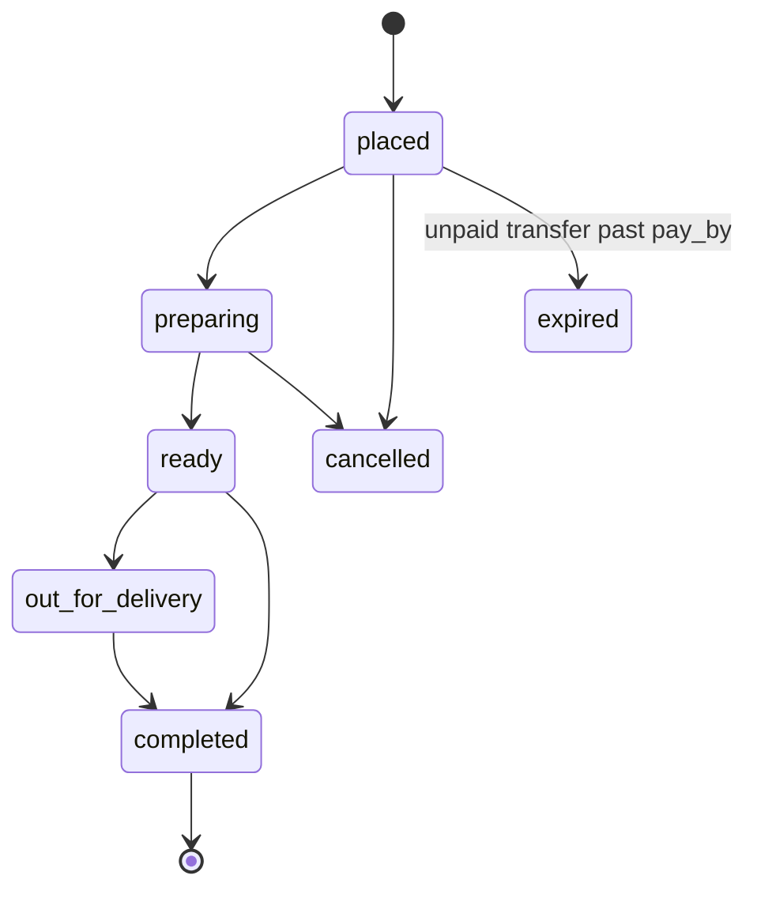

# Smart App PH analysis and design (Systems Analysis and Design)

Most rework in this repo started as a gap in the plan, not a bug in the code: a status nobody drew, a state with no screen, a feature that was never in scope. This skill turns the SAD course (SDLC, feasibility, requirements, context diagram, DFDs, data dictionary, process specs, ERDs, state diagrams, testing and rollout) into the habits every plan here follows.

AGENTS.md wins over this skill. Use it with `smartapp-prompt` (how the plan becomes a prompt) and `smartapp-data` (how the design becomes tables).

| Question                          | Source of truth                                                                                                                             |
| --------------------------------- | ------------------------------------------------------------------------------------------------------------------------------------------- |
| Is it in scope?                   | `docs/blueprints/A-mvp.md` section 1; `B-full.md` for later                                                                                 |
| Was it decided?                   | `docs/decisions.md` (T, N, R, S numbers)                                                                                                    |
| What can a screen call?           | `docs/api.md`                                                                                                                               |
| Which tables, flows and diagrams? | `docs/blueprints/database.md`; the "Smart App PH database blueprint" Claude Doc (context diagram, DFD level 0 and 1, ERDs, data dictionary) |
| Where are we?                     | `docs/PROGRESS.md`                                                                                                                          |

## 1. Our life cycle (SDLC)

We run an iterative cycle, one area at a time: **analyse → design → build on sample data (UI approved) → wire to the database (Done) → test → roll out**. A screen is only finished when it runs on the real database (`docs/PROGRESS.md`). Phases come from `A-mvp.md` section 3.

## 2. Scope and feasibility before anything else

- Trace every feature to a line in `A-mvp.md` section 1 or a decision in `decisions.md`. No line, no build: say "this is MVP B" or ask the founder.
- For anything new, check four kinds of feasibility in one line each: **technical** (our stack and rules allow it, e.g. no Realtime or edge functions, rule 13), **economic** (free or paid tier, cost per month), **operational** (a small shop owner can run it on a phone during a rush), **schedule** (does it delay the first paying shop?). If any answer is "no" or "unknown", raise it before planning.
- Protect the launch: name what to cut. The founder decides; record it in `decisions.md`.

## 3. Requirements

- Write the **functional** requirement as who does what: "The owner marks a GCash order paid after checking the proof."
- Write the **non-functional** ones that apply, with numbers: 360 to 1280 px, 44 px targets, 300 KB JS per storefront page, Lighthouse 90, Manila time, works on slow data, no customer data in logs.
- Every requirement gets a **done when** that a tester can check without asking you ("A rejected proof can be sent again; an approved one marks the order paid", `A-mvp.md` section 5).
- List every **state** the screen or flow can be in: loading, empty, error, offline, closed shop, long text, big amounts, plus each business state (paid, expired, cancelled).

## 4. Models we keep (and where)

Draw in Mermaid inside Markdown (GitHub renders it): `flowchart` for context diagrams and DFDs, `erDiagram` for ERDs, `stateDiagram-v2` for statuses.

| Model                   | Use it to answer                                                                | Where it lives                                            |
| ----------------------- | ------------------------------------------------------------------------------- | --------------------------------------------------------- |
| Context diagram         | who talks to the system (owner, customer, founder, Meta, Resend, Supabase Auth) | database blueprint doc; `database.md` section 1           |
| DFD level 0 and 1       | where each piece of data comes from and is stored                               | database blueprint doc                                    |
| ERD (logical, physical) | tables, keys, many-to-many                                                      | database blueprint doc; migrations are the physical truth |
| Data dictionary         | what each column means, its type and its rule                                   | database blueprint doc; `database.md` section 4           |
| State diagram           | every status and the allowed moves                                              | `A-mvp.md` section 4 (orders), `packages/core/src/rules`  |
| Decision table          | rules with several inputs (who can cancel, which orders expire)                 | the prompt or `decisions.md` entry                        |
| CRUD matrix             | who may create, read, update, delete each area                                  | database blueprint doc ("Access matrix and CRUD matrix")  |

A change to a table, flow or status updates its model in the same task. A model that disagrees with the code is a stop-and-ask (rule 2 of "Every task").

## 5. Statuses are state machines

- Each status list is an `as const` array plus a Zod enum and a database CHECK (rule 5).
- Draw it before building: every state, every allowed move, who may make it, and what happens to money, stamps and counts on each move. Order steps only move forward; completing needs paid; cancel needs a reason; nothing is deleted (`A-mvp.md` section 4).
- The allowed moves live in **one** place (a core rule function used by mocks and NestJS, enforced in SQL with `update … where status = $expected`). Screens ask; they never decide.
- A state with no screen, or a screen with no state, is a gap: fix the plan.

(Illustration only. An order may also jump forward to any later step for its type (T55), a transfer can't leave `placed` until paid, and nothing completes unpaid: `canAdvance` in `packages/core/src/rules/order-rules.ts` and `A-mvp.md` section 4 are the truth.)

## 6. Process specs

- For a rule with branches, write a decision table (conditions as columns, one row per case, the outcome last) before code. Example: expiry applies to GCash, Maya and bank orders that are unpaid past `pay_by`; cash and COD never expire.
- Write the steps of a flow in plain numbered English ("structured English") in the prompt, then match them one to one in tests.

## 7. Design: three layers, one contract

- Browser → NestJS → Postgres for everything (T34, rule 13). The contract is `docs/api.md` plus the Zod schemas; mock and API adapters follow it exactly (rule 3).
- Design the screen against the contract, not against the mock's internals; change `api.md` first, then the code.

## 8. Testing and rollout

- Unit tests for rules in `packages/core`; pgTAP for the database; contract tests so mock and API adapters return the same shapes; e2e for the flows in `A-mvp.md` section 5; the UI scan for every page.
- Acceptance (UAT) = the founder and one real food shop and one retail shop click through on a phone.
- Rollout is a **pilot**: one real shop first, on the live database, with a way back (export, backups). No big bang.

## 9. Change control

- Every approved change gets a numbered line in `docs/decisions.md` with the founder's words and date; `PROGRESS.md` gets one tick; `CHANGELOG.md` one line.
- Two docs disagree → stop and list both. Never pick one silently.

## Before you say a plan is ready

- [ ] It traces to `A-mvp.md` or a decision, and says what is out of scope
- [ ] Feasibility (technical, economic, operational, schedule) is one line each, no unknowns hidden
- [ ] Functional and non-functional requirements, each with a checkable "done when"
- [ ] Every state is listed; every status has its state diagram and one home for its rules
- [ ] Models touched (ERD, DFD, dictionary, CRUD) are updated in the same task
- [ ] The test plan names unit, database, contract and e2e checks

## Sources

- Mermaid, State diagrams: https://mermaid.js.org/syntax/stateDiagram.html (read from its GitHub source, 2026-11-20)
- Standard SAD course material (SDLC, feasibility, DFDs, data dictionary, decision tables, testing levels): Kendall and Kendall; Dennis, Wixom and Roth. Textbook knowledge, not looked up. The repo's own `A-mvp.md`, `database.md` and `decisions.md` were read 2026-11-20.
