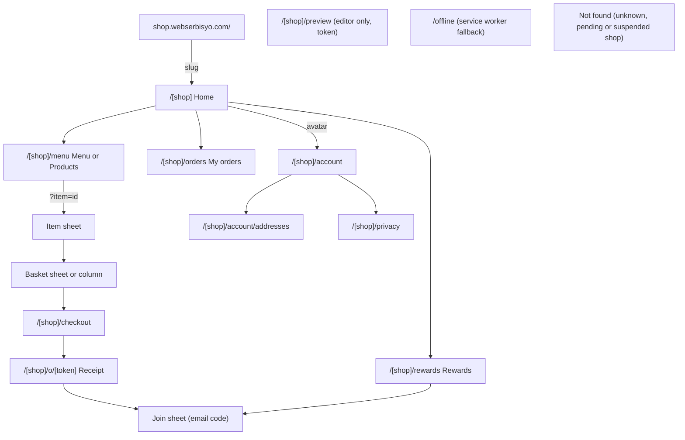
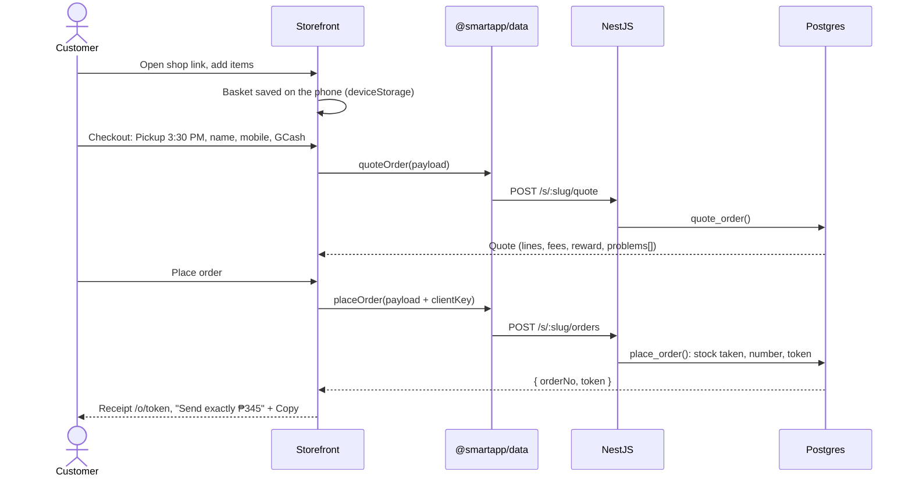
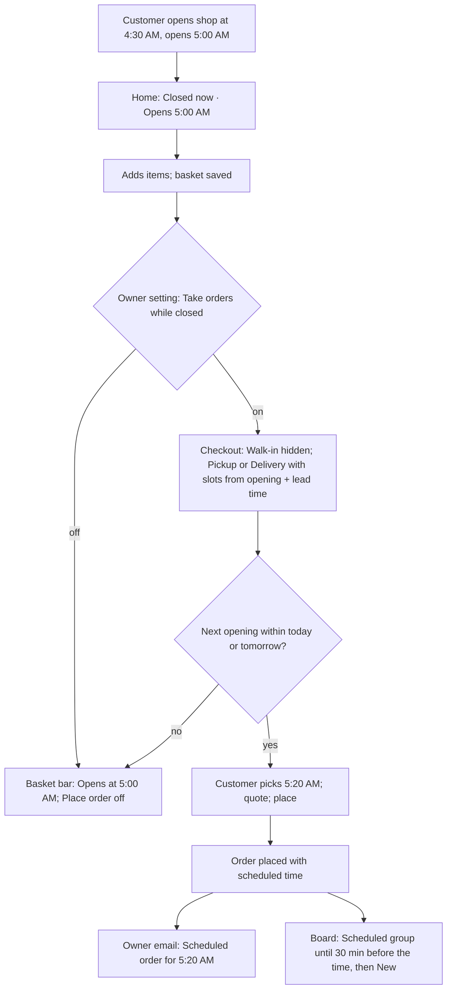
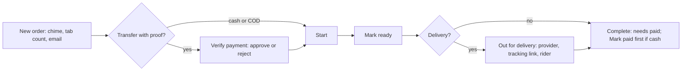
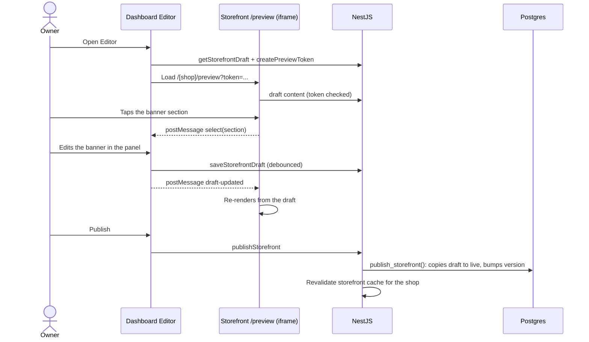

# Smart App PH: Launch MVP A Blueprint

> **Smart App PH: an installable ordering app, stamp card and owner dashboard for small Philippine shops**
> Webserbisyo · Prepared for: Juan Miguel Morales (founder) · Blueprint date: October 18, 2026 · Scope: Launch MVP A in full, Launch MVP B as stubs

This is the build blueprint: what every screen does, how the flows run, where the data lives and in what order it gets built. The why is in [`SYSTEM.md`](SYSTEM.md); the ecosystem and library research is in [`RESEARCH.md`](RESEARCH.md).

**Frontend-first rule:** the only real database work today is auth (`public.profiles`) and the 5 demo owner accounts. Every business feature runs on mock adapters in `@smartapp/data` that follow [`api.md`](api.md) and use the same Zod schemas as the NestJS API, so wiring an area to the backend changes one adapter switch, not the screens ([`blueprints/foundation.md`](blueprints/foundation.md) section 4).

**Docs rule:** this file stays general. It names libraries and kinds of components, never installed variant ids, block names or pinned versions (those belong in each task's prompt and in [`components.md`](components.md)). Versions live only in [`RESEARCH.md`](RESEARCH.md) section 1.

---

## Table of Contents

0. [How to use this blueprint](#0-how-to-use-this-blueprint)
1. [Research findings and key decisions](#1-research-findings-and-key-decisions)
2. [Requirements traceability](#2-requirements-traceability)
3. [Product definition](#3-product-definition)
4. [Information architecture](#4-information-architecture)
5. [Layouts and wireframes](#5-layouts-and-wireframes)
6. [Key user flows](#6-key-user-flows)
7. [Page specifications](#7-page-specifications)
8. [Feature deep dives](#8-feature-deep-dives)
9. [Design system](#9-design-system)
10. [Component needs](#10-component-needs)
11. [Library stack](#11-library-stack)
12. [Folder structure](#12-folder-structure)
13. [Database schema](#13-database-schema)
14. [Mock data](#14-mock-data)
15. [Phases and task plan](#15-phases-and-task-plan)
16. [QA matrix and demo script](#16-qa-matrix-and-demo-script)
17. [Launch MVP B module stubs](#17-launch-mvp-b-module-stubs)
18. [Open questions and doc overlaps](#18-open-questions-and-doc-overlaps)
19. [Sources](#19-sources)

---

## 0. How to use this blueprint

1. **Planning a task:** Claude reads the relevant sections here, writes one prompt in `docs/prompts/T<nn>-<name>.md`, and the prompt names the short docs the agent must read (`AGENTS.md`, `ux.md`, `api.md`...). Agents do not read this file unless a prompt names a section.
2. **Source of truth:** `AGENTS.md`, [`decisions.md`](decisions.md) and [`blueprints/`](blueprints/) win over this file. When they disagree, stop, list the conflict and fix one of them in a docs PR.
3. **Scope calls:** a marker **(N#)** points to a scope call the founder accepted on October 18, 2026 ([`decisions.md`](decisions.md), MVP A scope; [`SYSTEM.md`](SYSTEM.md) section 14).
4. **Adding to MVP A:** add the feature to section 3.4 with an ID, then its page spec (7), flow (6) if it has one, tables (13) and a line in the [`README.md`](../README.md) tracker. New tables or API methods also go to `api.md` first.
5. **Growing MVP B:** each module in section 17 is a stub with the same headings. Fill the stub in a docs PR before its first task; when a module is built, its tables and pages move into sections 4, 7 and 13 and the stub links to them.

---

## 1. Research findings and key decisions

### 1.1 What the ecosystem looks like (October 2026, summary)

The full table with versions and sources is [`RESEARCH.md`](RESEARCH.md) section 1. The points that shape this blueprint:

| Topic              | Finding                                                                                                      | Impact                                                                                      |
| ------------------ | ------------------------------------------------------------------------------------------------------------ | ------------------------------------------------------------------------------------------- |
| NestJS 12          | Runs on Node 20.19+ / 22.12+, but its CLI generators need Node 24.15+, and the founder's Mac runs 24.14      | Nest is written by hand; built-in Standard Schema validation takes our Zod schemas directly |
| Next.js 16.4       | Turbopack by default, `proxy.ts` instead of `middleware.ts`, Cache Components on in new apps, async `params` | Never cache code that reads cookies or the user; preview and checkout stay dynamic          |
| Serwist            | A Turbopack-native package exists; the core ships precaching, runtime caching and a background-sync queue    | PWA via Serwist; background sync is **not** used for orders (no iPhone support, see N2)     |
| Background Sync    | Supported in Chromium browsers; not supported in Safari or on iPhone                                         | Offline baskets wait for the customer to tap Place order again                              |
| Web push on iPhone | Works only for a site added to the Home Screen                                                               | Push is "Should"; the receipt page with live status is the main channel                     |
| Supabase Realtime  | Private channels are authorized by RLS policies on `realtime.messages`; checked at connect time              | Dashboard channel `shop:<tenantId>` is private; receipt channel uses the order token        |
| shadcn             | Base UI is the default primitive layer; registries (ReUI, DiceUI, Magic UI) install through the same CLI     | One install path; components land in `packages/ui` and are listed in `components.md`        |
| pnpm               | Settings live in `pnpm-workspace.yaml`; `minimumReleaseAge` holds back new releases                          | 7-day release age; exact versions                                                           |

### 1.2 Architecture Decision Records (ADR)

"Ref" points to the approved decision; **N#** rows are the MVP A scope calls in `decisions.md`.

| #      | Decision                                                                                                                                                   | Why                                                                             | Trade-off                                                      | Ref               |
| ------ | ---------------------------------------------------------------------------------------------------------------------------------------------------------- | ------------------------------------------------------------------------------- | -------------------------------------------------------------- | ----------------- |
| ADR-01 | Monorepo: `apps/{storefront,dashboard,api}` and `packages/{core,ui,data}` with pnpm + Turborepo                                                            | One repo, shared types and rules, one PR history; each host deploys its own app | Root directory set per host                                    | foundation §3     |
| ADR-02 | One Next.js storefront that is also the PWA (Serwist)                                                                                                      | One codebase for SEO pages, basket, login and member card                       | Turbopack-only PWA package                                     | T6, T18           |
| ADR-03 | Vite React SPA for the dashboard with TanStack Router and Query                                                                                            | Behind login, no SEO; static build wraps into a native app later                | Two front-end toolchains                                       | foundation §2     |
| ADR-04 | NestJS 12 from day 1, written by hand, ESM, Express adapter, Vitest                                                                                        | One API for both apps and MVP B; no CLI on Node 24.14                           | More files to write by hand                                    | F4, T14           |
| ADR-05 | Money, stock, stamps and order steps run in SQL functions; Nest validates, checks permission, calls them                                                   | One place for trusted rules; RLS still applies                                  | Logic split between TS and SQL; shared test table for statuses | foundation §8     |
| ADR-06 | Auth goes straight to Supabase; Nest checks the JWT with `jose` against the JWKS                                                                           | No auth server to build; asymmetric keys                                        | Two clients talk to Supabase (data package and API)            | foundation §5     |
| ADR-07 | Frontend first: mock adapters and API adapters implement the same `api.md` methods                                                                         | See every screen early; the swap is one switch per area                         | Mocks must keep the same rules (tested)                        | F2, F5, T12       |
| ADR-08 | Mock data from our own seeded generator, no faker or MSW                                                                                                   | Fewer packages, deterministic screenshots, typed by Zod                         | We write the generator                                         | foundation §4     |
| ADR-09 | Zod schemas in `@smartapp/core` are the one contract (forms, API input, adapter parsing, env)                                                              | One shape everywhere                                                            | Core builds to `dist` for Nest                                 | T14, T12          |
| ADR-10 | UI only from installed libraries (shadcn on Base UI, ReUI, DiceUI, Magic UI); hand-written needs the founder's OK                                          | Stops agents hand-writing components                                            | Some screens wait for a library part                           | F6                |
| ADR-11 | Tailwind v4 tokens only; CSS walls in ESLint                                                                                                               | Consistent look; brand colours through `cssVars()` only                         | New values need a token first                                  | T8, design-tokens |
| ADR-12 | Node 24.14 pinned; a package needing newer Node is pinned to an older version                                                                              | The founder's Mac cannot upgrade                                                | Some packages lag                                              | T7, T13, T19      |
| ADR-13 | One dev database now; a separate live database before the first paying shop; only the founder runs `db:push`                                               | No accidental writes to live data                                               | Manual step for every migration                                | T1, T9            |
| ADR-14 | Order steps only move forward, one transition table in core shared with SQL tests                                                                          | Screens never compare statuses; no Undo surprises                               | Mistakes are cancelled, not undone                             | foundation §4     |
| ADR-15 | Manual payment checks; reference unique per shop; only transfers expire unpaid                                                                             | No gateway fees at launch; stops reused proofs                                  | The owner does the checking                                    | P3, P7            |
| ADR-16 | Members join with a 6-digit email code; guest orders link by order token or email, never by phone alone                                                    | No customer passwords; phone numbers get recycled                               | Needs working email (Resend) before launch                     | P2, P8            |
| ADR-17 | Storefront light only; owner brand colour makes a 60/30/10 palette with a contrast check                                                                   | Every shop looks like its own app and stays readable                            | No storefront dark mode                                        | P4, design-tokens |
| ADR-18 | Closed shop: next-opening slots as normal orders with a later time; no new status                                                                          | Turns closed hours into sales with no new state                                 | Owner must notice Scheduled orders (board group + email)       | **N1**            |
| ADR-19 | Offline: no background order sending; Place order waits for the connection and re-quotes                                                                   | No iPhone support; prices and stock must be live; no silent late orders         | Customer taps again after reconnecting                         | **N2**            |
| ADR-20 | Favourites stored on the phone only in A                                                                                                                   | Zero backend; "Order again" covers repeat buying                                | Lost when the phone changes                                    | **N3**            |
| ADR-21 | Up to 2 variant choices per item (30 variants max); add-on groups are a shared library with min and max                                                    | Covers size, colour and sugar level without a product-matrix engine             | No 3-axis variants; no add-on stock in A                       | **N4**            |
| ADR-22 | Append-only stamp ledger; balance cached on the customer row by the same functions; manual changes capped                                                  | Auditable and fast lists                                                        | Cache must be updated only by SQL functions                    | **N5**, P2        |
| ADR-23 | Editor: draft stored as one Zod-checked JSON per shop, published by one SQL function; preview is the real storefront in an iframe with a short-lived token | Edits the actual template; customers never see half edits                       | Two-window messaging between dashboard and preview             | **N7**            |
| ADR-24 | Dashboard navigation: Home, Orders, Menu or Products, Members, Editor, Insights, Settings                                                                  | Matches the jobs an owner does daily; stamps live with members                  | Changes `ux.md` section 1                                      | **N9**            |
| ADR-25 | New-order email to the owner in MVP A                                                                                                                      | Owners will not keep the dashboard open                                         | Needs Resend and a sender domain before launch                 | **N10**           |

---

## 2. Requirements traceability

Every goal, ask and acceptance item mapped to where it lives. "Phase" follows [`blueprints/A-mvp.md`](blueprints/A-mvp.md) section 3 (2 storefront mock, 3 dashboard mock, 4 backend, 5 launch).

| Requirement (source)                                                                      | Where it lives                                                                         | Phase   |
| ----------------------------------------------------------------------------------------- | -------------------------------------------------------------------------------------- | ------- |
| Launch fast to the first paying shops (project goal 1)                                    | Scope cuts in [`SYSTEM.md`](SYSTEM.md) 4.3; task plan 15                               | all     |
| Build MVP B in parallel without breaking live (project goal 2)                            | Per-shop module switches; stubs 17; additive migrations only                           | after 5 |
| Members and the stamp card are the selling point                                          | 7.4 Rewards, 7.17 to 7.19 Members and Stamp card, 8.4 stamps engine, flows 6.8 to 6.13 | 2, 3, 4 |
| Saved orders when the shop is closed or offline (founder, Oct 18)                         | 8.2, flows 6.2 and 6.3, 7.6 basket, 7.7 checkout                                       | 2, 4    |
| Favourites (founder, Oct 18)                                                              | 8.3, 7.3 menu, 7.5 item                                                                | 2       |
| Side dishes, variants and add-ons with required or optional (founder)                     | 8.1, 7.5 item sheet, 7.16 product editor, flow 6.4                                     | 2, 3, 4 |
| Dashboard stamps: 3 types, configs, first-time vs existing, manual distribution (founder) | 8.4, 7.17 to 7.20, flows 6.10 to 6.13                                                  | 3, 4    |
| Editor with on-page live editing; AI logo colour analyser (founder)                       | 8.5, 8.6, 7.21, flows 6.14 and 6.15                                                    | 3, 4    |
| Insights (founder)                                                                        | 8.7, 7.22                                                                              | 3, 4    |
| Final MVP A left sidebar (founder)                                                        | 4.5 navigation model                                                                   | 1 (T05) |
| Storefront PWA plus useful libraries (founder)                                            | 11 library stack; [`RESEARCH.md`](RESEARCH.md) section 2                               | 2       |
| Walk-in, pickup, delivery as owner switches (A-mvp)                                       | 7.7 checkout, 7.23 settings ordering                                                   | 2, 3    |
| Cash, COD, GCash, Maya, bank with proof (P3)                                              | 7.8 receipt, 7.15 order detail, flow 6.6                                               | 2, 3, 4 |
| Zone pick, "Use my location", Maps link, straight-line km                                 | 7.7 checkout, 7.15 order detail, 8.2                                                   | 2, 3    |
| Delivery booked by hand with a tracking link                                              | 7.15 order detail, flow 6.16                                                           | 3, 4    |
| Private ratings and Google review link                                                    | 7.8 receipt, 7.22 insights                                                             | 2, 3    |
| Web push for order status only                                                            | 8.8, 7.8 receipt                                                                       | 4       |
| Only GCash, Maya and bank orders expire unpaid                                            | 13.5 jobs, flow 6.17                                                                   | 4       |
| Shop isolation (A-mvp §4, acceptance 5)                                                   | 13.1 conventions, [`SYSTEM.md`](SYSTEM.md) 10                                          | 4       |
| Lighthouse 90+, JS budget (acceptance 7)                                                  | 16 QA matrix; library budget in 11                                                     | 2, 5    |
| Privacy page and consents (acceptance 8)                                                  | 7.11 privacy, 13.3 `consents`                                                          | 2, 4    |
| Live DB, proof deletion job, price decision (open launch gaps)                            | 13.5 jobs, 15 phase 5, 18 open questions                                               | 5       |

---

## 3. Product definition

### 3.1 Personas

**Carla Bautista, owner, Panaderya ni Lola Remy (food, primary)**
34, runs her lola's bakeshop in Malolos with two helpers. Uses a mid-range Android phone all day; opens a laptop at night. Gets pasalubong box orders on Messenger and pays suppliers by GCash.
_Pain:_ orders for the 3 PM pandesal batch get lost in chat; GCash screenshots she cannot match; regulars she cannot reward.
_Needs:_ a chime and one button per order, a "to verify" list, a stamp card her suki understand, and setting up her shop from her phone.

**Bea Villanueva, owner, Tala Apparel (retail)**
29, sells clothes in sizes S to XL and three colours; ships within Cebu by Lalamove.
_Pain:_ "Available pa po ba size M in sand?" messages all day; customers paying for sizes that ran out.
_Needs:_ size and colour variants with their own stock, sold out per variant, delivery zones with fees, a storefront that looks like her brand.

**Paolo Reyes, owner, Kanto Smash Burgers (food, rush hours)**
31, late-night rush of 40 orders an hour.
_Needs:_ walk-in QR at the counter, add-ons that are always right (required patty choice, optional extras), "Goes well with" fries to lift the average order, a board that never makes him scroll.

**Maria Santos, customer (student)**
21, budget Android phone on prepaid data, orders pickup coffee at Kapé Juan between classes.
_Needs:_ order in under a minute, see the stamp count go up, save her favourite drink, not lose her basket when the shop is still closed at 6:50 AM or the signal drops.

**Mang Ramon's customers, repeat buyers (AquaLinis water)**
Households that order the same 2 to 4 gallons every week, often COD.
_Needs:_ "Order again" in two taps and a remembered address.

### 3.2 Design goals (what "good" means)

1. **One-minute order:** shop link to placed order in under 60 seconds on a phone.
2. **Two-tap owner:** a new order is seen and moved forward in two taps from the Orders tab.
3. **Nothing lost:** the basket and checkout details survive a reload, a closed shop and a dropped signal.
4. **Trust:** a screenshot never marks an order paid; numbers come from the server.
5. **Stamps everywhere they look:** progress on Home, basket, receipt and Rewards.
6. **Works on a ₱7,000 phone:** fast first load on slow data, light images, motion off when reduced motion is set.
7. **Calm for a new shop:** empty states with one action, no scary zeros or % drops.

### 3.3 Roles and permissions

The matrix is in [`SYSTEM.md`](SYSTEM.md) section 5. In MVP A every dashboard user is the owner; permission names are still used on every API route (`@Can('orders.manage')`) so staff roles in MVP B add rows, not code paths.

### 3.4 Feature catalog

Priority: **M** must, **S** should (may slip to just after launch). IDs are stable; add new rows at the end of each group.

**Storefront (SF)**

| ID    | Feature                                                                                              | MVP | Pri | Spec     |
| ----- | ---------------------------------------------------------------------------------------------------- | --- | --- | -------- |
| SF-01 | Shop home (banners, announcement, reward card, categories, best sellers, About, hours, contact)      | A   | M   | 7.2      |
| SF-02 | Phone shell (top bar, area pill, floating 4-tab dock, basket bar); desktop top nav and sticky basket | A   | M   | 5.1      |
| SF-03 | Menu or Products: search, sticky category chips, sold-out greyed, `?item=` links                     | A   | M   | 7.3      |
| SF-04 | Item sheet: photos, variants (2 choices max), add-on groups with min and max, qty, note              | A   | M   | 7.5, 8.1 |
| SF-05 | "Goes well with" suggestions on item and basket                                                      | A   | S   | 8.1      |
| SF-06 | Favourites on the phone, Favourites chip                                                             | A   | S   | 8.3      |
| SF-07 | Basket on the phone per shop, flagged lines                                                          | A   | M   | 7.6, 8.2 |
| SF-08 | Closed or paused shop: basket kept, next-opening slots (N1)                                          | A   | M   | 8.2, 6.2 |
| SF-09 | Offline: basket and details kept, Place order waits (N2)                                             | A   | M   | 8.2, 6.3 |
| SF-10 | One-page checkout with quote before Place order                                                      | A   | M   | 7.7      |
| SF-11 | Delivery zone, nearest zone from location, map pin, Maps link                                        | A   | M   | 7.7      |
| SF-12 | Receipt: number, QR, live status, proof upload, order thread, tracking, Messenger hand-off           | A   | M   | 7.8      |
| SF-13 | My orders and "Order again"                                                                          | A   | S   | 7.9, 8.3 |
| SF-14 | Private rating and Google review link                                                                | A   | S   | 7.8      |
| SF-15 | Web push for order status ("Notify me")                                                              | A   | S   | 8.8      |
| SF-16 | PWA install, offline page, install card                                                              | A   | M   | 7.12     |
| SF-17 | Privacy page, consent line, opt-ins                                                                  | A   | M   | 7.11     |
| SF-18 | Brand palette 60/30/10 from one colour and the logo                                                  | A   | M   | 9        |
| SF-19 | Synced basket and favourites for members                                                             | B   |     | 17 M13   |
| SF-20 | Dine-in table ordering                                                                               | B   |     | 17 M6    |

**Members and stamps (MB)**

| ID    | Feature                                                             | MVP | Pri | Spec      |
| ----- | ------------------------------------------------------------------- | --- | --- | --------- |
| MB-01 | Join with 6-digit email code; joining again returns the same member | A   | M   | 7.10, 6.8 |
| MB-02 | Welcome stamp (owner switch, default 1)                             | A   | M   | 8.4       |
| MB-03 | Earn on completed paid orders over the minimum; reverse on reversal | A   | M   | 6.9       |
| MB-04 | Reward type: peso discount                                          | A   | M   | 6.10      |
| MB-05 | Reward type: free item from the catalog                             | A   | M   | 6.10      |
| MB-06 | Reward type: custom prize with claim code and QR                    | A   | M   | 6.11      |
| MB-07 | Rewards tab: card, progress, history, claims                        | A   | M   | 7.4       |
| MB-08 | Member QR that opens the member in the dashboard                    | A   | S   | 6.12      |
| MB-09 | Link guest orders by order token or same email                      | A   | M   | 6.8       |
| MB-10 | Tiers, stamps per peso, expiry, double-stamp days                   | B   |     | 17 M19    |

**Dashboard (DB)**

| ID    | Feature                                                                                            | MVP | Pri | Spec          |
| ----- | -------------------------------------------------------------------------------------------------- | --- | --- | ------------- |
| DB-01 | Auth: sign-up, login, reset by code, Setup, Pending, Suspended                                     | A   | M   | 7.13          |
| DB-02 | Google sign-in (T01b)                                                                              | A   | S   | 7.13          |
| DB-03 | Home: checklist, needs-you items, today's numbers                                                  | A   | M   | 7.14          |
| DB-04 | Orders board (live, chime, Scheduled group, age warnings) and list by date                         | A   | M   | 7.15          |
| DB-05 | Order detail (proof, approve or reject, cash, advance, cancel, tracking, rider, slip)              | A   | M   | 7.15          |
| DB-06 | Order badges: First order, Member, Reward used                                                     | A   | S   | 8.4           |
| DB-07 | Catalog: categories, items, photos, variants, stock and sold out, archive                          | A   | M   | 7.16          |
| DB-08 | Add-on library and "Goes well with" picks                                                          | A   | M   | 7.16, 8.1     |
| DB-09 | Members list with segments and member detail                                                       | A   | M   | 7.17, 7.18    |
| DB-10 | Stamp card settings with preview and impact warning                                                | A   | M   | 7.19          |
| DB-11 | Manual stamps with reason, cap and audit                                                           | A   | M   | 7.18, 6.12    |
| DB-12 | Prize claims list                                                                                  | A   | M   | 7.20          |
| DB-13 | Editor with Draft and Publish                                                                      | A   | M   | 7.21, 8.5     |
| DB-14 | Logo colour helper                                                                                 | A   | S   | 8.6           |
| DB-15 | Insights and CSV export                                                                            | A   | M   | 7.22, 8.7     |
| DB-16 | Settings: info, hours, closures, pause, ordering, closed-shop scheduling, zones, payments, account | A   | M   | 7.23          |
| DB-17 | New-order email to the owner                                                                       | A   | M   | 8.8           |
| DB-18 | Share my shop: link and printable QR                                                               | A   | M   | 7.24          |
| DB-19 | `/kit` page (dev only)                                                                             | A   | M   | components.md |
| DB-20 | POS, shifts, kitchen, staff, inventory, promos, full reports, admin                                | B   |     | 17            |

**Platform (PL)**

| ID    | Feature                                                      | MVP | Pri | Spec          |
| ----- | ------------------------------------------------------------ | --- | --- | ------------- |
| PL-01 | Multi-shop with RLS everywhere and the same check in the API | A   | M   | 13.1          |
| PL-02 | Server-computed totals, stock and stamps                     | A   | M   | 13.4          |
| PL-03 | Gap-free daily order numbers; retry-safe placement           | A   | M   | 13.4          |
| PL-04 | Unpaid transfer expiry; proof deletion after 30 days         | A   | M   | 13.5          |
| PL-05 | Abuse limits                                                 | A   | M   | 13.4          |
| PL-06 | Founder approval and billing by SQL                          | A   | M   | SYSTEM App. A |
| PL-07 | Live database with backups before the first paying shop      | A   | M   | 15 phase 5    |

---

## 4. Information architecture

### 4.1 Storefront sitemap



### 4.2 Storefront route table

| Path                                  | Page                                                  | Access                         | Rendering and cache                                                | Built in |
| ------------------------------------- | ----------------------------------------------------- | ------------------------------ | ------------------------------------------------------------------ | -------- |
| `/`                                   | Platform root: short page with a link for owners      | Public                         | Static                                                             | T04      |
| `/[shop]`                             | Home                                                  | Public                         | Server-rendered, cached per shop, revalidated on publish and edits | T04, T06 |
| `/[shop]/menu`                        | Menu or Products (`?q=`, `?cat=`, `?fav=1`, `?item=`) | Public                         | Cached catalog; stock and sold out refreshed in the background     | T07      |
| `/[shop]/rewards`                     | Stamp card, rewards, claims                           | Public (join prompt) or member | Dynamic for members                                                | T12      |
| `/[shop]/orders`                      | My orders (device tokens, member history)             | Public                         | Dynamic, never cached                                              | T11      |
| `/[shop]/checkout`                    | Checkout                                              | Public                         | Dynamic, never cached                                              | T09      |
| `/[shop]/o/[token]`                   | Receipt                                               | Anyone with the link           | Dynamic, never cached, `noindex`                                   | T10      |
| `/[shop]/o/[token]/image`             | Receipt as a PNG for Save receipt (N11)               | Anyone with the link           | Dynamic, never cached, `noindex`                                   |
| `/[shop]/account`                     | Profile, addresses, notifications, privacy, sign out  | Member                         | Dynamic                                                            | T12      |
| `/[shop]/account/addresses`           | Saved addresses with optional pin                     | Member                         | Dynamic                                                            | T12      |
| `/[shop]/privacy`                     | Privacy notice (English + short Filipino)             | Public                         | Static per shop                                                    | T14      |
| `/[shop]/preview`                     | Draft preview for the Editor                          | Owner with preview token       | Dynamic, `noindex`, never cached, framed only by the dashboard     | T21      |
| `/offline`                            | Offline fallback with the shop name                   | Service worker                 | Precached                                                          | T13      |
| `/[shop]/manifest.webmanifest`, icons | Per-shop install data                                 | Public                         | Cached, revalidated on publish                                     | T13      |

The basket is a sheet on phones, a right drawer from 1024 to 1279 px and a sticky column from 1280 px ([`ux.md`](ux.md) section 1); it has no route. Join is a sheet that opens from the receipt, Rewards and Account.

### 4.3 Dashboard sitemap

```mermaid
flowchart TD
    Login["/login"] --> Signup["/signup"]
    Login --> Reset["/reset (code)"]
    Login -->|no shop| Setup["/setup"]
    Setup --> Pending["/pending"]
    Login -->|suspended| Suspended["/suspended"]
    Login -->|active| Home["/ Home"]
    subgraph Shell["Signed-in shell (sidebar, rail or dock)"]
      Home
      Orders["/orders"] --> OrderDetail["/orders/$orderId"]
      Catalog["/catalog Menu or Products"] --> ItemEdit["/catalog/$itemId"]
      Catalog --> Categories["/catalog/categories"]
      Catalog --> AddOns["/catalog/add-ons"]
      Members["/members"] --> Member["/members/$customerId"]
      Members --> StampCard["/members/stamp-card"]
      Members --> Claims["/members/claims"]
      Editor["/editor"]
      Insights["/insights"]
      Settings["/settings"] --> SShop["/settings/shop"]
      Settings --> SHours["/settings/hours"]
      Settings --> SOrdering["/settings/ordering"]
      Settings --> SDelivery["/settings/delivery"]
      Settings --> SPayments["/settings/payments"]
      Settings --> SAccount["/settings/account"]
    end
    QR["/m/$code (member QR)"] --> Member
    Kit["/kit (dev only)"]
```



### 4.4 Dashboard route table

| Path                               | Page                                                    | Guard                               | Built in |
| ---------------------------------- | ------------------------------------------------------- | ----------------------------------- | -------- |
| `/login`, `/signup`, `/reset`      | Owner auth                                              | Guest only                          | T01, T15 |
| `/setup`                           | Create shop: kind, name, link name                      | Signed in, no shop                  | T15      |
| `/pending`, `/suspended`           | Waiting for approval; suspended                         | Signed in, shop in that state       | T15      |
| `/`                                | Home                                                    | Active shop                         | T16      |
| `/orders`                          | Board (open) and list (`?date=`)                        | Active shop                         | T17      |
| `/orders/$orderId`                 | Order detail (side panel next to the board at 1280 px+) | Active shop                         | T17      |
| `/catalog`                         | Items list (table or grid), filters, sold-out switches  | Active shop                         | T18      |
| `/catalog/$itemId`, `/catalog/new` | Item editor                                             | Active shop                         | T18      |
| `/catalog/categories`              | Categories with icons and order                         | Active shop                         | T18      |
| `/catalog/add-ons`                 | Add-on group library                                    | Active shop                         | T18      |
| `/members`                         | Customers and members with segments                     | Active shop                         | T19      |
| `/members/$customerId`             | Member detail, stamp history, manual stamps             | Active shop                         | T19      |
| `/members/stamp-card`              | Stamp card settings                                     | Active shop                         | T20      |
| `/members/claims`                  | Prize claims                                            | Active shop                         | T20      |
| `/m/$code`                         | Member QR landing; redirects to the member              | Active shop (login first if needed) | T19      |
| `/editor`                          | Storefront editor                                       | Active shop                         | T21      |
| `/insights`                        | Insights                                                | Active shop                         | T22      |
| `/settings/*`                      | Settings sections, each with its own Save               | Active shop                         | T23      |
| `/kit`                             | Component showcase                                      | Dev or `VITE_SHOW_KIT`              | T01, T02 |

Every signed-in route re-checks the shop status every 30 seconds and on focus ([`ux.md`](ux.md) section 6).

### 4.5 Navigation model (final MVP A sidebar, N9)

One list in `apps/dashboard/src/app/nav.ts`, read by the sidebar, the rail and the dock. Labels come from `words.ts` and vocab.

| Order | Item                     | Icon idea (lucide)                   | Badge                                  | Phone dock     |
| ----- | ------------------------ | ------------------------------------ | -------------------------------------- | -------------- |
| 1     | Home                     | `house`                              | Needs-you count                        | Tab 1          |
| 2     | Orders                   | `receipt-text`                       | Open orders (amber when any to verify) | Tab 2          |
| 3     | Menu or Products (vocab) | `utensils` or `package` (vocab icon) | Sold-out count                         | Tab 3          |
| 4     | Members                  | `users`                              | Prizes to give                         | Tab 4          |
| 5     | Editor                   | `paintbrush`                         | Dot when a draft is unpublished        | More sheet     |
| 6     | Insights                 | `chart-column`                       | none                                   | More sheet     |
| 7     | Settings                 | `settings`                           | Dot when setup is incomplete           | More sheet     |
| foot  | View my shop             | `external-link`                      |                                        | More sheet     |
| foot  | Share my shop            | `qr-code`                            |                                        | More sheet     |
| foot  | Account menu (avatar)    |                                      |                                        | Top bar avatar |

Desktop sidebar: shop logo and name on top (with the open, busy or closed state and a quick Pause), the 7 items, then View my shop and Share, account at the bottom. Phone: bottom dock Home · Orders · Menu or Products · Members · More. Tablet: 72 px rail.

MVP B adds items in fixed spots so the order never reshuffles: Sell (POS) after Orders, Kitchen after Sell, Stock after Menu or Products, Staff and Promotions before Settings.

---

## 5. Layouts and wireframes

Breakpoints, shells, phone feel, states and accessibility are in [`ux.md`](ux.md); sizes and colours in [`design-tokens.md`](design-tokens.md). This section adds wireframes for screens that are new or changed by this blueprint. Phone wireframes are at 390 px.

### 5.1 Shells (summary)

- **Storefront phone:** top bar (logo, name, open state, area pill, bell, avatar), content, basket bar, floating dock. Bars hide while the keyboard is open.
- **Storefront desktop (1024 px+):** top navigation, content max 1120 px, basket drawer (1024 to 1279) or sticky 360 px column (1280+). Checkout and receipt are one column, max 640 px, at every width.
- **Dashboard:** dock on phone, rail on tablet, 248 px sidebar on laptop and up; light and dark.
- **Editor:** its own full-width layout inside the shell (sidebar collapses to the rail).

### 5.2 Item sheet with add-on rules (phone)

```
┌──────────────────────────────┐
│ [ photo carousel • ○ ○ ]  [x]│
│ Classic Smash                │
│ Smashed beef, cheese, potato │
│ bun                          │
│ from ₱149  ♡                 │
├──────────────────────────────┤
│ Patty           Required · 1 │
│ (•) Single             ₱149  │
│ ( ) Double             ₱209  │
│ Make it spicy?  Optional · 1 │
│ ( ) Sriracha mayo       +₱0  │
│ ( ) Jalapeño           +₱15  │
│ Extras        Up to 3        │
│ [ ] Bacon              +₱40  │
│ [ ] Cheese slice       +₱20  │
│ [ ] Egg (sold out)           │
│ Note [ no onions          ]  │
│ Goes well with               │
│ [Fries ₱69 +] [Iced tea ₱45+]│
├──────────────────────────────┤
│ [-] 1 [+]   [ Add · ₱149 ]   │  sticky; says "Choose a patty"
└──────────────────────────────┘    until required picks are made
```

### 5.3 Basket when the shop is closed (phone)

```
┌──────────────────────────────┐
│ < Your basket                │
│ ⓘ Closed now · Opens 5:00 AM │  warning tone
│   Your basket is saved.      │
│ 10x Classic Pandesal   ₱50   │
│ 2x  Ube Cheese Pandesal ₱30  │
│ ⚠ Spanish Bread is sold out  │  left out of the total
│   [Remove]                   │
│ Goes well with               │
│ [Brewed Coffee ₱40 +]        │
│ Subtotal               ₱80   │
│ ★★★☆☆ 3 of 10 stamps         │
├──────────────────────────────┤
│ [ Schedule for 5:20 AM ▸ ]   │  only when scheduling is on;
└──────────────────────────────┘  otherwise "Opens at 5:00 AM"
```

### 5.4 Rewards tab (phone, member)

```
┌──────────────────────────────┐
│ Rewards                      │
│ ┌──────────────────────────┐ │
│ │ Kapé Juan Coffee         │ │  member colour, dot pattern
│ │ ● ● ● ● ● ● ● ○ ○ ○      │ │
│ │ 7 of 10 · 3 more to any  │ │
│ │ 16 oz drink free         │ │
│ └──────────────────────────┘ │
│ How to earn                  │
│ 1 stamp per drink order of   │
│ ₱130 or more, once it's done │
│ My member QR  [Show]         │
│ History                      │
│ +1 Order #042    Oct 17      │
│ +1 Welcome       Oct 12      │
│ +1 Given at counter (Juan)   │
└──────────────────────────────┘
```

### 5.5 Dashboard home (desktop)

```
┌──────────┬──────────────────────────────────────────────────────────┐
│ (logo)   │ Good morning, Carla          [View my shop] [Share]      │
│ Lola Remy│ ┌ Setup 4 of 6 ─────────────────────────────────────────┐ │
│ ● Open   │ │ ✓ Logo  ✓ Hours  ○ Payment account  ○ Stamp card      │ │
│ Home     │ └───────────────────────────────────────────────────────┘ │
│ Orders 3 │ [2 to verify] [1 scheduled for 3 PM] [1 prize to give]    │
│ Menu     │ ┌Sales today┐┌Orders┐┌Avg order┐┌New members┐              │
│ Members  │ │ ₱3,322    ││18 · 3││ ₱185    ││ 4         │              │
│ Editor • │ └───────────┘└──────┘└─────────┘└───────────┘              │
│ Insights │ In progress (list)               │ Best sellers today     │
│ Settings │                                  │                        │
│ ──────── │                                  │                        │
│ View shop│                                  │                        │
│ (avatar) │                                  │                        │
└──────────┴──────────────────────────────────────────────────────────┘
```

### 5.6 Members and member detail (phone)

```
┌──────────────────────────────┐   ┌──────────────────────────────┐
│ Members              [⌕]     │   │ < Maria Santos   Member      │
│ [All 124][New 9][Regulars 31]│   │ Since Oct 12 · 14 orders     │
│ [Reward ready 3][Almost 7]   │   │ ₱2,340 spent · last 2 days   │
│ [Quiet 30d 18][Guests 210]   │   │ ● ● ● ● ● ● ● ○ ○ ○  7/10    │
│ ┌──────────────────────────┐ │   │ [Give stamp] [Remove stamp]  │
│ │ Maria S. · 7/10 ★        │ │   │ Stamp history                │
│ │ 14 orders · 2 days ago   │ │   │ +1 Order #042 · system       │
│ └──────────────────────────┘ │   │ +1 Counter purchase · Carla  │
│ ┌──────────────────────────┐ │   │ −1 Correction · Carla        │
│ │ Jun R. · Reward ready 🎁 │ │   │ Orders  ·  Notes and tags    │
│ └──────────────────────────┘ │   └──────────────────────────────┘
└──────────────────────────────┘
```

### 5.7 Stamp card settings (desktop)

```
┌───────────────────────────────────────────┬──────────────────────┐
│ Stamp card                       [On ●]   │ Preview (phone)      │
│ Earn                                       │ ┌──────────────────┐ │
│ 1 stamp per completed order of at least    │ │ ● ● ○ ○ ○ ○ ○ ○  │ │
│ ₱[ 250 ]                                   │ │ 2 of 8           │ │
│ Stamps needed [ 8 ]   Welcome stamp [On]   │ │ Free Classic     │ │
│ Reward                                     │ │ Smash (single)   │ │
│ ( ) Peso discount  ₱[   ]                  │ └──────────────────┘ │
│ (•) Free item  [Classic Smash ▾][Single ▾] │                      │
│ ( ) Custom prize  title, picture, details  │                      │
│ ⚠ Lowering to 8 makes 3 members' rewards   │                      │
│   ready now.                     [Save]    │                      │
└───────────────────────────────────────────┴──────────────────────┘
```

### 5.8 Editor (desktop and phone)

```
Desktop
┌───────┬──────────────────────────────────────┬───────────────────────┐
│ rail  │ [Phone ▣][Desktop ▭]  Draft · saved   │ Banner (2 of 3)       │
│       │ ┌──────────────────────┐ [Discard]   │ [image] [Replace]     │
│       │ │ (logo) Kanto Smash   │ [Publish]   │ Title [ Late night...]│
│       │ │╔════════════════════╗│             │ Link  [ /menu?cat=..] │
│       │ │║ banner  ✎ selected ║│             │ [+ Add slide]         │
│       │ │╚════════════════════╝│             │ Section  [Shown ●]    │
│       │ │ (i) announcement  ✎  │             │                       │
│       │ │ Reward card       ✎  │             │                       │
│       │ │ Best sellers      ✎  │             │                       │
│       │ └──────────────────────┘             │                       │
└───────┴──────────────────────────────────────┴───────────────────────┘

Phone: full-screen preview; tap a section to open its panel as a bottom
sheet; a floating bar shows "Draft · [Publish]".
```

---

## 6. Key user flows

Each flow lists the happy path, then the edge cases the screens and the server must handle. Error codes are from [`api.md`](api.md); new codes are listed in 13.7.

### 6.1 Guest order (pickup, GCash)



Edge cases:

- Double tap or retry: the same `clientKey` returns the same order.
- The quote finds problems (price changed, sold out, option removed, zone fee changed): the basket shows each line's problem; Place order is off until the customer accepts or removes them.
- Pickup time no longer valid (shop closed early, slot passed): `pickup_time_invalid`; the slot list refreshes.
- Too many unpaid orders from this phone: `rate_limited` with "Finish or cancel your other order first".
- Unpaid transfer order not paid within the time limit: Expired, stock returned (6.17).

### 6.2 Closed shop with scheduling on (N1)



Rules:

- Slots start at opening time plus the shop's lead time (default 20 minutes) and stay inside hours; today or tomorrow only.
- A paused or busy shop offers only slots after `busy_until`.
- Transfer orders still need a proof within the unpaid time limit (the customer can upload while the shop is closed); cash and COD wait for the owner.
- If the owner changes hours after the order, the order keeps its time; the owner can cancel with a reason.
- A closed day (closure) is skipped when finding the next opening.

### 6.3 Customer offline (N2)

1. The service worker serves the saved shop page; the top shows "You're offline. Showing your saved menu."
2. Adding to the basket works (saved on the phone). Prices show as last seen.
3. Checkout fields can be filled and are saved as a draft on the phone.
4. Place order is off and says "You're offline. Your basket is saved."
5. When the phone reconnects, the page re-quotes automatically; changes are flagged; Place order turns on.
6. Nothing is sent in the background. If the tab is closed, the basket is waiting next time.

### 6.4 Choosing options (variants, add-ons, side dishes)

1. The item sheet opens with required groups first. A required single-choice group with an owner default is pre-selected.
2. The Add button shows the line price as picks change and says what is missing ("Choose a patty").
3. Tapping Add with a missing pick scrolls to the first unfinished group and highlights it.
4. "Goes well with" items show below the options with their own "+" (quick add when they have no required choices, otherwise they open their own sheet).
5. The basket merges identical lines (same item, variant, options and note) by adding quantities.
6. The server re-checks every rule in `quote_order` and `place_order` (`invalid_options` with the group name).

Edge cases: every option of a required group sold out (the item shows "Not available today"); a variant sold out but others not (only that choice is greyed); the owner edits a group while the item is in a basket (the line is flagged at quote); an add-on price of ₱0 shows "Free".

### 6.5 Order again

1. My orders lists past orders (device order tokens for guests, account history for members).
2. "Order again" puts every still-available line in the basket with today's prices and options.
3. Lines that changed or are unavailable are listed in a sheet ("2 items added, 1 not available: Ube Ensaymada") before opening the basket.

### 6.6 Payment proof and verification

As in [`SYSTEM.md`](SYSTEM.md) 6.4, plus:

- The proof appears as the first message in the order thread with the reference number.
- At most 3 proofs per order; upload only while unpaid and within 7 days.
- A rejected proof shows the reason in the thread and on the receipt with Upload again.
- A duplicate reference (per shop, among proofs not rejected) is refused before saving: `duplicate_reference`. References are compared without spaces or dashes, in capitals.
- Rejecting a proof sets the payment back to unpaid and restarts the unpaid timer, and the reference can be used again.
- A transfer order paid in cash at the counter is recorded as cash (`recordPayment`). An order with a ₱0 total is paid at once.
- Approve, reject, record cash, cancel and stock changes each write an `audit_log` row.

### 6.7 Owner handles an order



One next-step button from core `nextActions()`. Cancel is in the More menu and needs a reason; cancelling returns stock and any redeemed stamps, sets pending proofs to rejected, and a paid order notes that the refund is by hand.

The screens call the owner order methods in [`api.md`](api.md) (Orders, owner): `listOrders`, `getOrderDetail`, `getProofUrl`, `reviewPayment`, `recordPayment`, `advanceOrder`, `cancelOrder` and `saveDeliveryInfo`. In Nest they live in `modules/orders`: each route checks the owner with `@Can()`, takes the shop from `tenant_members`, and calls the SQL function that does the work.

### 6.8 Join as a member and link past orders

1. On the receipt: "Join to earn stamps · this order counts".
2. The customer enters an email and gets a 6-digit code (60-second resend timer).
3. After the code: `joinAsMember` creates or returns the member for this shop, sets `member_since`, gives the welcome stamp (if on), and links this order by its token.
4. Past guest orders with the same email are linked; their completed paid orders add stamps once. Phone numbers alone never link.
5. Joining again (another phone) returns the same member.

### 6.9 Earn and reverse stamps

- When an order becomes Completed and paid and its total (before the reward discount) meets the minimum: +1 stamp with reason `earned`, once per order.
- If a completed order is later reversed (refund recorded by the owner in MVP B, or a correction): −1 with reason `reversed`. Cancelled orders before completion never earned a stamp.
- Stamps are given only by SQL functions; the dashboard and storefront never write the ledger.

### 6.10 Redeem a discount or a free item

1. The member's stamps reach the goal: the Rewards tab, home card and basket show "Reward ready", with confetti once.
2. At checkout a "Use my reward" switch appears (only one reward per order).
3. **Discount:** the quote subtracts the reward amount, capped at the subtotal; delivery fee is never discounted.
4. **Free item:** the quote adds the chosen item and variant at ₱0 (marked as the reward line); paid add-ons on it are charged; if it is sold out the switch says "Free item sold out today" and stays off.
5. `place_order` writes `redeemed` (−goal) to the ledger. Cancel or expiry writes it back (`reversed`).

### 6.11 Claim a custom prize

```mermaid
sequenceDiagram
    actor M as Member
    participant SF as Storefront
    participant API as NestJS
    participant DB as Postgres
    actor O as Owner
    M->>SF: Rewards: Claim "Free tote bag"
    SF->>API: claimReward
    API->>DB: claim_reward(): stamps -goal, claim pending, 6-char code
    SF-->>M: Show QR and code; "Show this at the shop"
    M->>O: Shows QR at the counter
    O->>O: Scans with phone camera, opens /m/code or Members > Claims
    O->>API: giveClaim
    API->>DB: claim given (time, owner)
    Note over O,DB: Cancel with a reason returns the stamps
```

Pending claims show on the owner's Home ("1 prize to give") and on Members > Claims.

### 6.12 Give a stamp at the counter (manual)

1. A member buys at the counter without ordering in the app and shows their member QR.
2. The owner scans it with the phone's own camera; the QR holds `app.webserbisyo.com/m/<code>`, which opens the member in the dashboard (login first if needed).
3. The owner taps Give stamp, picks a reason (Counter purchase, Correction, Goodwill, Other with text) and confirms.
4. `adjust_stamps` checks: owner only, reason present, at most 3 manual stamps per member per Manila day, balance never below 0. The ledger row records the owner and reason; the audit log records the action.
5. The member sees it in their history as "Given at the counter".

### 6.13 Change the stamp rule

1. The owner edits the minimum, goal, welcome stamp or reward.
2. Before saving, `previewStampRuleChange` shows the impact: how many members would have a reward ready now, whether pending claims keep their old reward (they do).
3. Saving bumps the rule `version`. Existing stamps stay. Rewards redeemed later use the rule at that time; claims keep a snapshot.
4. Turning the card off hides Rewards on the storefront and stops earning; balances are kept; pending claims can still be given.

### 6.14 Edit and publish the storefront



Edge cases: two tabs editing (the save sends the draft's version; an older version gets `draft_conflict` and reloads); an image upload fails (the section keeps the old image and shows Retry); the preview token expires (refreshed silently every few minutes); leaving with unsaved changes (the draft is saved automatically, so nothing is lost; Publish is still needed).

### 6.15 Logo colour helper

1. The owner uploads or changes the logo in the Editor.
2. On the phone, the logo's main colours are read (no upload to an AI service).
3. The helper shows up to 3 suggestions, each a 60/30/10 palette from `shopPalette()` with its contrast result; failing ones are not shown.
4. The owner taps one to try it in the preview, or picks a colour by hand. Nothing is live until Publish.

### 6.16 Delivery with a tracking link

1. The order is Ready; the owner books a rider in Lalamove, Grab or their own way.
2. Out for delivery: pick the provider (Own rider, Lalamove, Grab, Other), paste the tracking link (https; Lalamove and Grab links must be on their hosts), optional rider name and phone.
3. The receipt shows "Track your delivery" and the rider; push if the customer opted in.
4. The owner sees the straight-line km from the shop pin to the delivery pin, labelled "straight line".

### 6.17 Unpaid transfer expiry (job)

Every minute, `expire_unpaid_orders()` moves placed transfer orders with no pending or confirmed payment past `unpaid_expiry_minutes` to Expired, returns stock and any redeemed stamps, and writes an order event. Cash and COD orders never expire.

---

## 7. Page specifications

Every page implements the states in [`ux.md`](ux.md) section 3 (loading skeleton, empty with one action, error with Try again, offline, closed or paused shop, long text, big amounts). Only extra states are listed below.

### Storefront

#### 7.1 Shell

Top bar 56 px: logo, name, open state ("Open until 9 PM", "Closed · Opens 5 AM", "Busy · back 3:40 PM"), area pill (order type and zone, remembered per shop), bell (order updates for the device's orders), avatar (Account or Join). Floating dock: Home, Menu or Products, Rewards (hidden when the card is off), Orders. Basket bar above the dock with count, total and View; hidden at 0 items and on checkout and receipt.

#### 7.2 Home `/[shop]`

Banners (up to 3; none shows a brand card with logo and tagline), announcement strip (tone, end date), reward card or "Join and get 1 free stamp", favourites row (when any), categories, best sellers (owner featured items first, then top sellers from the last 30 days), About, hours (today highlighted, closures noted), contact (call, Messenger, Facebook, Maps), members count if the owner shows it. Sections the owner turned off in the Editor are not rendered.

#### 7.3 Menu or Products `/[shop]/menu`

Sticky search and category chips with scroll spy; a Favourites chip when any exist; 2-column photo grid on phone (3 to 4 on desktop with a category rail). Card: photo, name, price or "from ₱X", sold-out tag, heart. "+" adds at once when the item has one variant and no required groups; otherwise it opens the item. Empty search: "No match for 'xyz'" with Clear. `?item=<id>` opens the item sheet over the menu.

#### 7.4 Rewards `/[shop]/rewards`

Signed out: what the stamp card gives, "Join and get 1 free stamp", sign in. Member: stamp card, how to earn, reward ready state with Use at checkout (discount, free item) or Claim (custom prize), pending claim with QR and code, member QR button, history (earned, redeemed, reversed, welcome, given at the counter). Card off: the tab is hidden; a direct link shows "This shop has no stamp card right now".

#### 7.5 Item sheet (`?item=`)

Bottom sheet on phone, dialog on desktop. Photo carousel, name, description, price, heart, variant choices (one control per axis; impossible combinations greyed with "Not available"), add-on groups in owner order with their rule label ("Required · Choose 1", "Optional · Up to 3", "Choose 2 to 4"), quantity (1 to 99), note (120 characters), "Goes well with", sticky Add button with the line total. Rules in 8.1.

#### 7.6 Basket

Lines with photo, name, variant, options summary, note, quantity stepper and remove. Flagged lines (sold out, price changed, option gone) are shown with the reason and left out of the total until resolved. "Goes well with" row (up to 3 items, not already in the basket). Stamp progress ("This order earns 1 stamp" or "Spend ₱70 more to earn a stamp"). Closed shop banner and button per 6.2. Clear basket in a More menu with a confirm. Saved per shop on the phone; a version key resets incompatible old baskets with a one-line notice.

#### 7.7 Checkout `/[shop]/checkout`

One column, max 640 px, three groups:

1. **How:** order types the shop allows right now; pickup time (ASAP, or slots today or tomorrow from 20 minutes out, inside hours; only slots when closed); delivery zone (fee and ETA), "Use my location" to suggest the nearest zone, address line, landmark, optional pin ("Use my current location", removable).
2. **Who:** name, mobile (accepts 0917…, 917…, +63…), email optional (prefilled for members); "Remember me on this phone" (on).
3. **Pay:** methods the order type allows (COD only for delivery, pay on pickup only if allowed); transfer shows the account, QR, "Send exactly ₱345" with Copy. Reward switch for members with a ready reward.

Totals (subtotal, discount, delivery fee, total), consent line with the privacy link, Place order. The quote runs on open, on every change (debounced) and right before placing. A disabled Place order always says why.

#### 7.8 Receipt `/[shop]/o/[token]`

Big order number and type, QR of this page ("Show this at pickup"), scheduled time if any, live status timeline (Realtime with a 15-second poll fallback), items and totals, payment status. Transfer unpaid: Upload proof (camera or gallery, compressed) and reference. Order thread: proof first, then system lines. Delivery: Track your delivery, rider. After completion: rating (1 to 5 stars, optional comment up to 300), "Review us on Google" if set. Messenger hand-off with the order text, Copy order details, Save receipt (a PNG made on the server from the order at `/[shop]/o/[token]/image` with the Next.js built-in image response, no new package), Print or Save as PDF (print layout), Save or Share link, Notify me (push), Join to earn stamps, install card after the first order. Footer: "ORDER SLIP · NOT AN OFFICIAL RECEIPT".

#### 7.9 My orders `/[shop]/orders`

Open orders first, then past ones. Guests: orders whose tokens are saved on this phone. Members: account history from any device. Each row: number, date, status, total, Order again.

#### 7.10 Account `/[shop]/account` and Join sheet

Join: email, 6-digit code, 60-second resend. Account: name and phone, email, saved addresses, notifications (push on or off for this phone), marketing opt-ins per channel (unticked by default), privacy link, sign out. Member QR is on Rewards.

#### 7.11 Privacy `/[shop]/privacy`

The shop's notice in plain English with a short Filipino summary: what is collected, why, how long, who sees it (only this shop), rights under the Data Privacy Act and how to ask for deletion (by contacting the shop in MVP A).

#### 7.12 PWA, offline and system pages

Per-shop manifest and icons from the logo; in-app splash once per session in standalone mode (at most 600 ms); offline page with the shop name and "Your basket is saved"; Not found for unknown, pending or suspended shops; install card with iPhone steps after joining or a first order. Never cached: receipts, checkout, quotes, proof uploads, auth, preview and API answers (decision T6).

### Dashboard

#### 7.13 Auth and setup

Login (narrow card, show or hide password, one error for every failed login), sign-up, reset by code, Google button after T01b. Setup: kind (food or retail, changes vocab), shop name, link name with a live "is it free" check. Pending: what happens next and a Messenger link to the founder. Suspended: why and how to fix it.

#### 7.14 Home `/`

Setup checklist until done (logo and colour, hours, payment account, first item, order types, stamp card). Needs-you chips hidden at 0: to verify, waiting to start, scheduled soon, low stock, prizes to give, unpublished draft. Today's numbers (Manila day): sales, orders (open count), average order, new members. In progress list and best sellers today. No % comparisons or date pickers.

#### 7.15 Orders `/orders` and order detail

Board columns: New, Preparing, Ready, Out (delivery), Done today; a Scheduled group above New for orders more than 30 minutes ahead. Card: number, type icon, scheduled time, name, badges (First order, Member, Reward), items summary, total, payment chip, age (amber at 10 minutes, red at 20). One next-step button. "Turn on order sound" until the first tap; open count in the tab title. List view by date with search by number, name or phone.

Detail: timeline, customer (call, Messenger, member link), items with options, totals and reward, payment with proof zoom, reference with Copy, "Check this reference in your own GCash app", Approve or Reject with a reason, Record cash, delivery info (zone, address, landmark, Maps link of the pin, straight-line km), provider, tracking link and rider, rating, Print slip, Cancel with a reason.

#### 7.16 Menu or Products `/catalog`

List as table (desktop) or cards (phone) with a grid toggle; filters by category, status (active, hidden, archived) and stock (sold out, low). Inline Visible and Sold out switches. Item editor: photos (up to 5, sortable, compressed), name, description, category, featured, variant choices (up to 2 axes with values; the grid of variants with price, stock on/off, stock, low at, sold out), add-on groups (attach from the library, order them), "Goes well with" (up to 4 items), visibility. Leave guard on unsaved edits. Archive instead of delete when the item has orders (`item_has_orders`). Categories page: name, icon, order, hide. Add-ons page: groups with min, max, options (name, price, default, sold out) and which items use them.

#### 7.17 Members `/members`

Segments as chips with counts (rules in 8.4): All, New this month, Regulars, Reward ready, Almost there, Quiet 30 days, Guests. Search by name, phone, email or member code. Row: name, member or guest, stamps, orders, last order, total spent. Export CSV (members of this shop only, with an export line in the audit log).

#### 7.18 Member detail `/members/$customerId`

Header: name, member since, orders, total spent, first and last order, stamp card. Actions: Give stamp, Remove stamp (reason and confirm; remaining manual stamps today shown), Mark prize given for a pending claim. Tabs: Stamp history (each row with reason, order link, actor, time), Orders, Notes and tags. Guests show the same page without the stamp parts and with "Not a member yet".

#### 7.19 Stamp card `/members/stamp-card`

On or off, minimum order, stamps needed (4 to 20), welcome stamp (on or off), reward type and its fields (discount amount; free item and variant picker; custom prize title, picture, description and how to claim). Live preview of the card. Impact warning before saving (6.13). Explains in one line that stamps come only from completed paid orders.

#### 7.20 Claims `/members/claims`

Pending, given and cancelled tabs. Row: member, prize, code, claimed time. Actions: Mark given, Cancel with a reason (returns stamps).

#### 7.21 Editor `/editor`

As 5.8 and 8.5: preview of the real storefront in a phone or desktop frame, section outlines on hover or tap, the selected section's panel, Draft status ("Saved", "Saving…", "Unpublished changes"), Discard and Publish. Logo colour helper inside the Brand panel. Opening a Settings-owned field (hours, address) links to its Settings page.

#### 7.22 Insights `/insights`

Range: 7 days or 30 days (Manila days). Blocks in 8.7. Each block has a one-line takeaway and, where it helps, an action link (for example "3 members have a reward ready" links to that segment). CSV export of orders for the range. A new shop with no data shows each block's empty state, not zeros.

#### 7.23 Settings `/settings/*`

Each section saves on its own.

- **Shop:** name, kind (read-only after approval), link name (read-only after approval), phone, email, address, barangay, city, shop pin (current location or pasted Google Maps link), Facebook page, Messenger username, Google review link, show members count.
- **Hours:** weekly hours (up to 2 ranges per day, overnight allowed), closures with notes, pause orders now (for 15, 30, 60 minutes or until I resume).
- **Ordering:** order types on or off, pay on pickup allowed, COD allowed, take orders while closed (N1), pickup lead time, unpaid time limit for transfers.
- **Delivery:** zones with fee, ETA text, optional minimum order and a centre point for "Use my location".
- **Payments:** GCash, Maya and bank accounts with name, number and QR picture.
- **Account:** owner name, email, password, sign-in methods, sign out of all devices.

#### 7.24 Share my shop

Sheet with the link, Copy, Share, and a printable counter QR card (logo, name, "Scan to order", link) as an image or PDF.

---

## 8. Feature deep dives

### 8.1 Catalog model: variants, add-ons, side dishes and combos (N4)

| Concept               | What it is                                                | Data                                            | Rules                                                                                                                    |
| --------------------- | --------------------------------------------------------- | ----------------------------------------------- | ------------------------------------------------------------------------------------------------------------------------ |
| Item                  | What the customer sees on the menu                        | `items`                                         | Status active, hidden or archived; at least one variant; up to 5 photos                                                  |
| Variant choice (axis) | Up to 2 per item, such as Size, Colour, Weight            | `items.variant_axes`                            | 1 to 10 values per axis; at most 30 variants                                                                             |
| Variant               | One combination with its own price and stock              | `item_variants`                                 | Price ≥ ₱0; stock optional per item; sold out by hand or at 0 stock; a removed combination is archived, never deleted    |
| Add-on group          | A question inside one line ("Sugar level", "Extras")      | `option_groups`, linked by `item_option_groups` | `min_select` 0 to 10, `max_select` 1 to 10, min ≤ max; min ≥ 1 means required; max 1 means single choice; shared library |
| Option                | One answer in a group                                     | `options`                                       | Price change ≥ ₱0 (no negative prices in A); default flag; sold out flag; each option at most once per line              |
| Goes well with        | Other items suggested next to this item and in the basket | `item_pairings`                                 | Up to 4 per item; never itself; hidden or archived items are skipped; added as their own lines                           |
| Combo                 | One item with choice groups ("Choose your drink")         | item + option groups                            | Choices are plain options in A; linking a choice to another item's stock is MVP B                                        |

Line identity: item, variant, sorted option ids and note; identical lines merge. Line price = variant price + sum of option price changes, times quantity. Every rule above is checked again in `quote_order` and `place_order` with the same Zod schema and SQL checks.

Retail example (Tala Basic Tee): axes Size (S, M, L, XL) and Colour (Black, White, Sand) make 12 variants; the owner can bulk-set price and stock, then mark "M · Sand" sold out.

Food example (Kapé Juan Spanish Latte): axis Size (12 oz, 16 oz); groups "Sugar level" (required, choose 1, default 100%), "Milk" (optional, choose 1: Oat milk +₱40), "Extra shot" (optional, up to 2 options).

### 8.2 Basket, closed shop and offline (N1, N2)

| Situation                                            | Basket                    | Checkout                                                     | Owner sees                           |
| ---------------------------------------------------- | ------------------------- | ------------------------------------------------------------ | ------------------------------------ |
| Open                                                 | On the phone per shop     | All allowed types; ASAP or a time                            | New order                            |
| Busy (paused for a time)                             | Kept                      | Slots after the pause only; walk-in hidden                   | Scheduled order                      |
| Closed, scheduling on, opens today or tomorrow       | Kept                      | Pickup or delivery at next-opening slots only                | Scheduled group; email with the time |
| Closed, scheduling off, or opens later than tomorrow | Kept                      | Place order off: "Opens Tue 10:00 AM. Your basket is saved." | Nothing                              |
| Paused indefinitely ("until I resume")               | Kept                      | Place order off: "Not taking orders right now"               | Nothing                              |
| Phone offline                                        | Kept; checkout draft kept | Place order off until online; re-quote on reconnect          | Nothing until placed                 |
| Shop suspended or not found                          | Kept but hidden           | Not found page                                               | n/a                                  |

Storage: one `deviceStorage` in `packages/data` (versioned keys per shop: basket, favourites, checkout draft, guest order tokens, area choice). Only data the customer typed or chose; no payment proofs.

Synced baskets for members across devices are MVP B (M13).

### 8.3 Favourites and Order again (N3)

- **Favourites:** a heart on cards and the item sheet; saved on the phone per shop as item ids; the Favourites chip filters the menu; a favourites row on Home when there are any; archived or hidden items drop out silently. No login needed. Synced favourites for members: MVP B.
- **Order again:** from My orders and the receipt; rebuilds lines from the order snapshot using today's items, variants and options; anything missing is listed before the basket opens.

### 8.4 Stamps engine (N5, N6)

**Owner configuration (`loyalty_rules`, one row per shop):**

| Field                                                     | Values                                                    | Default      |
| --------------------------------------------------------- | --------------------------------------------------------- | ------------ |
| `is_active`                                               | on, off                                                   | off          |
| `min_order_total`                                         | centavos, 0 or more (subtotal before the reward discount) | 0            |
| `stamps_needed`                                           | 4 to 20                                                   | 10           |
| `welcome_stamps`                                          | 0 or 1                                                    | 1            |
| `reward_kind`                                             | `discount`, `free_item`, `custom`                         | `discount`   |
| `reward_amount`                                           | centavos (discount)                                       | 10000 (₱100) |
| `reward_item_id`, `reward_variant_id`                     | the free item                                             | none         |
| `reward_title`, `reward_description`, `reward_image_path` | custom prize, also used as the card label                 | "₱100 off"   |
| `version`                                                 | bumped on every save                                      | 1            |

**Ledger reasons (append-only `loyalty_ledger`):** `welcome` (+1), `earned` (+1, one per order), `redeemed` (−goal, at placement), `reversed` (undoes `earned` or `redeemed`), `claim` (−goal for a custom prize), `claim_cancelled` (+goal), `manual_add` (+1), `manual_remove` (−1). The balance is the sum; `customers.stamp_balance` is a cache written by the same SQL functions in the same transaction.

**First-time vs existing (tracking):** `customers` keeps `first_order_at`, `last_order_at`, `order_count`, `completed_count`, `total_spent` and `member_since`, updated by `place_order` and `advance_order`. Orders store `is_first_order`. Segments:

| Segment        | Rule                                                               |
| -------------- | ------------------------------------------------------------------ |
| New this month | `member_since` or `first_order_at` within the current Manila month |
| Regulars       | `completed_count` ≥ 3                                              |
| Reward ready   | member, card on, `stamp_balance` ≥ `stamps_needed`                 |
| Almost there   | member, card on, `stamps_needed` − `stamp_balance` between 1 and 2 |
| Quiet 30 days  | `last_order_at` older than 30 days                                 |
| Guests         | `member_since` is null                                             |

**Manual distribution and changes:** owner only (`stamps.adjust`); ±1 per action; reason required (Counter purchase, Correction, Goodwill, Other with text); at most 3 manual changes per member per Manila day (`stamp_cap_reached`); balance never below 0 (`stamps_insufficient`); ledger row with `actor_id` and note; audit log entry. Insights shows manual stamps as their own number so abuse is visible. Bulk giving to many members is MVP B (with promotions).

**Rule changes:** see 6.13. Claims and redemptions keep a snapshot of the reward.

**Not in A (MVP B M19):** several reward tiers, stamps per peso spent, stamp expiry, double-stamp days, birthday stamps.

### 8.5 Editor (N7)

**What can be edited (draft content, `StorefrontContentSchema` in core):**

| Section           | Fields                                                             | On/off | Owned by   |
| ----------------- | ------------------------------------------------------------------ | ------ | ---------- |
| Brand             | Logo, brand colour (or advanced 60/30/10), tagline                 | always | Draft      |
| Banners           | Up to 3 slides: image or YouTube, title, link                      | yes    | Draft      |
| Announcement      | Text, tone (info, promo, warning), end date                        | yes    | Draft      |
| Reward card       | Shown when the stamp card is on; edits jump to Stamp card settings | yes    | Stamp card |
| Favourites row    | Customer's own; nothing to edit                                    | yes    | n/a        |
| Categories        | Order and icons; edits jump to Menu or Products                    | always | Catalog    |
| Best sellers      | Featured items (pick up to 8) or automatic                         | yes    | Draft      |
| About             | Text (up to 600 characters)                                        | yes    | Draft      |
| Hours and contact | Shown from Settings; edits jump to Settings                        | always | Settings   |

**Draft and publish:** one draft per shop (`storefront_drafts.data`, validated by Zod on save and in SQL by required keys), saved automatically. Publish runs `publish_storefront()` which copies the draft into `shop_settings` and `shop_banners` in one transaction, bumps `content_version` and records an audit entry; the API then revalidates the storefront cache for the shop. Discard deletes the draft. Settings-owned and catalog-owned fields save immediately and are not part of the draft (hours and prices must apply at once).

**Preview mechanics:** the storefront route `/[shop]/preview` renders the same components as the live home, reading the draft through the API with a signed preview token (short-lived, owner-only, shop-bound). It is `noindex`, never cached, and only allows framing by the dashboard origin. The two windows talk by `postMessage` with origin checks: the preview sends `select(section)`; the dashboard sends `draft-updated` and `set-frame(phone|desktop)`.

**Phone editing:** full-screen preview; tapping a section opens its panel as a bottom sheet; a floating bar shows the draft state and Publish.

**Not in A (MVP B M21):** section reorder, more templates, custom blocks, fonts, custom CSS, scheduled publishing, version history beyond the last published.

### 8.6 Logo colour helper (N8)

- Runs on the owner's device: the logo image is drawn small, its pixels grouped, and up to 5 main colours found (transparent, near-white and near-black ignored).
- Each candidate goes through `shopPalette()` (core) to make 60/30/10 and the contrast check; up to 3 passing palettes are shown with a "Brand from your logo" label.
- No AI model, no upload to another service, no cost. Library choice (colour extraction and OKLCH maths) is a later research task; candidates are listed in [`RESEARCH.md`](RESEARCH.md) section 2.3.
- MVP B M20: an AI brand assistant that also suggests a tagline, banner text and palette names.

### 8.7 Insights (MVP A)

All numbers from `get_insights(range)` (one SQL function, Manila days, completed orders unless stated).

| Block        | Shows                                                             | Why it matters (action)       |
| ------------ | ----------------------------------------------------------------- | ----------------------------- |
| Sales        | Sales total, orders, average order, by day (bar)                  | Is the shop growing           |
| Order types  | Walk-in, pickup, delivery, scheduled: count and sales             | Which channel to promote      |
| Payments     | Cash, COD, GCash, Maya, bank; rejected proofs count               | Where payment friction is     |
| Best sellers | Top 10 items by quantity and sales; top add-ons                   | What to feature in the Editor |
| Busy hours   | Orders by hour of day                                             | When to prepare or pause      |
| Members      | New members, member share of sales, repeat customer rate          | Is the stamp card working     |
| Stamps       | Earned, manual, redeemed, prizes given; reward-ready count (link) | Spot abuse; nudge members     |
| Ratings      | Average, count, latest comments                                   | Service quality               |
| Lost orders  | Cancelled and expired with top reasons                            | Fix what loses sales          |

Formulas: average order = sales ÷ completed orders; repeat customer rate = customers with 2 or more completed orders in the range ÷ customers with 1 or more; member share = member sales ÷ all sales. Comparisons with the previous period, cohorts and Sheets are MVP B (M14).

### 8.8 Notifications (MVP A)

| Who      | Event                                     | Channel                                                      | Pri                   |
| -------- | ----------------------------------------- | ------------------------------------------------------------ | --------------------- |
| Owner    | New order (and scheduled order)           | Dashboard chime, tab count, realtime; email via Resend (N10) | M                     |
| Owner    | Proof uploaded                            | Dashboard ("to verify")                                      | M                     |
| Customer | Status change, proof approved or rejected | Receipt live status; web push if "Notify me"                 | M (receipt), S (push) |
| Customer | Email code                                | Email via Supabase Auth SMTP (Resend)                        | M                     |

Push and email go through `notification_outbox` (one row per message, retried with backoff) sent by a Nest worker. Marketing messages are MVP B and need opt-ins.

---

## 9. Design system

[`design-tokens.md`](design-tokens.md) is the source for colours, type, shape, motion and the shop palette; [`ux.md`](ux.md) for layout, states and accessibility. Summary for planning:

- **Personality:** friendly, local, trustworthy. Plain English with local words (Suki, Members, pasalubong in demo data), short verb buttons, errors that say what to do next, never "Coming soon".
- **Colour:** platform blue in the dashboard; each storefront in its own 60/30/10 palette; fixed meaning colours (success, warning = "it needs you", destructive, info, member teal, marigold for celebrations only).
- **Type and shape:** Plus Jakarta Sans; 12 to 28 px scale in rem; 4 px grid; buttons 12 px radius, cards 16 to 20, sheet tops 24.
- **Motion:** under 400 ms, off for reduced motion; confetti only when a reward is ready, once.
- **Accessibility:** AA contrast, visible focus, labels and linked errors, keyboard-only checkout, 44 px targets on touch, 16 px inputs.

Microcopy examples (all in `words.ts`):

| Moment                | Text                                                         |
| --------------------- | ------------------------------------------------------------ |
| Closed, scheduling on | "Closed now · Opens 5:00 AM. Schedule your order for later." |
| Offline               | "You're offline. Your basket is saved."                      |
| Missing required pick | "Choose a patty"                                             |
| Price changed         | "Price changed from ₱149 to ₱159"                            |
| Reward ready          | "Your reward is ready! Use it on this order?"                |
| Manual stamp cap      | "You've given 3 stamps to Maria today. Try again tomorrow."  |
| Draft                 | "Unpublished changes. Customers still see the old version."  |

---

## 10. Component needs

General needs only. Each task's prompt names the exact components to install; [`components.md`](components.md) lists what is installed. Libraries: shadcn on Base UI (primitives and blocks), ReUI (richer parts), DiceUI (specialised inputs), Magic UI (small delights, never on core flows).

| Need                                            | Kind of component                                  | Used in                                     |
| ----------------------------------------------- | -------------------------------------------------- | ------------------------------------------- |
| Sheets on phone, dialogs and drawers on desktop | Drawer, dialog, responsive dialog                  | Item, basket, join, filters, editor panels  |
| Choice controls with rule labels                | Radio group, checkbox group, toggle group, stepper | Item sheet, settings                        |
| Variant grid editing                            | Data grid or table with inline inputs              | Item editor                                 |
| Sortable lists                                  | Sortable                                           | Photos, categories, add-on groups, pairings |
| Photo upload with crop and progress             | File upload, cropper                               | Logo, banners, items, proofs                |
| Colour pick and palette preview                 | Colour picker                                      | Editor brand panel                          |
| Carousel                                        | Carousel                                           | Banners, item photos                        |
| Announcement strip                              | Banner                                             | Home                                        |
| Stamp card visual                               | Card plus a subtle pattern; confetti               | Rewards, home, basket                       |
| Status and badges                               | Badge mapped once to tokens                        | Board, receipt, members                     |
| Timeline                                        | Timeline                                           | Receipt, order detail                       |
| Order thread                                    | Message, bubble, attachment                        | Receipt, order detail                       |
| QR display                                      | QR code                                            | Receipt, member QR, claims, share           |
| Rating                                          | Rating                                             | Receipt                                     |
| OTP input                                       | Input OTP                                          | Join, reset                                 |
| Charts                                          | Chart (lazy-loaded)                                | Insights                                    |
| Tables with filters                             | Data table                                         | Members, orders list, catalog               |
| Navigation                                      | Sidebar, bottom dock, tabs                         | Both shells                                 |
| Toasts                                          | Toast through one `notify()` helper                | Everywhere                                  |

Hand-written components need the founder's OK (F6). Patterns used by 3 or more screens go in `packages/ui/src/compositions/` with the founder's OK.

---

## 11. Library stack

Names only; versions are in [`RESEARCH.md`](RESEARCH.md) section 1. "T01" means installed by the foundation task; "Planned" means named in `foundation.md` for a later task; "Candidate" means proposed here and needs the founder's yes before install (`AGENTS.md` rule 10).

| Package                                                                              | Purpose                                                  | Where             | Status         |
| ------------------------------------------------------------------------------------ | -------------------------------------------------------- | ----------------- | -------------- |
| next, react, react-dom                                                               | Storefront                                               | storefront        | T01            |
| vite, @vitejs/plugin-react                                                           | Dashboard build                                          | dashboard         | T01            |
| @tanstack/react-router, @tanstack/react-query                                        | Dashboard routes; server state in both apps              | dashboard, data   | T01            |
| react-hook-form, @hookform/resolvers, zod                                            | Forms and the shared contract                            | dashboard, core   | T01            |
| tailwindcss, tw-animate-css, cva, clsx, tailwind-merge, lucide-react, @base-ui/react | Styling, primitives, icons                               | ui                | T01            |
| @supabase/supabase-js, @supabase/ssr                                                 | Auth client, cookie sessions in `proxy.ts`               | data              | T01            |
| @nestjs/* (core, common, platform-express, config, terminus, testing), helmet, jose  | API                                                      | api               | T01            |
| vitest, unplugin-swc, supertest, Testing Library, jsdom                              | Tests                                                    | all               | T01            |
| @serwist/turbopack, serwist                                                          | PWA service worker, precache, offline page, push handler | storefront        | Planned        |
| @nestjs/throttler                                                                    | Rate limits on public routes                             | api               | Planned        |
| pino logging for Nest                                                                | JSON logs without customer data                          | api               | Planned        |
| Playwright + axe                                                                     | Smoke and accessibility tests                            | tooling           | Planned        |
| knip                                                                                 | Unused files and packages                                | root              | Planned        |
| Drizzle ORM                                                                          | API database access with RLS per request (MVP B)         | api               | Planned (B)    |
| embla carousel (via the shadcn carousel)                                             | Banners, item photos                                     | ui                | Candidate      |
| input-otp (via the shadcn OTP input)                                                 | 6-digit codes                                            | ui                | Candidate      |
| recharts (via the shadcn chart)                                                      | Insights charts, lazy-loaded                             | dashboard         | Candidate      |
| qrcode                                                                               | Receipt, member, claim and share QR codes                | core or ui        | Candidate      |
| libphonenumber-js                                                                    | Forgiving PH mobile input and +63 normalising            | core              | Candidate      |
| date-fns, @date-fns/tz                                                               | Manila time, slots, business date                        | core              | Candidate      |
| canvas-confetti                                                                      | Reward-ready moment                                      | ui                | Candidate      |
| nuqs                                                                                 | Typed URL state (`?item=`, `?cat=`, `?q=`)               | storefront        | Candidate      |
| web-push                                                                             | Sending order-status push from the Nest worker           | api               | Candidate      |
| @nestjs/schedule                                                                     | Outbox worker timing (SQL jobs stay in pg_cron)          | api               | Candidate      |
| Colour extraction + OKLCH maths                                                      | Logo colour helper and `shopPalette()`                   | core or dashboard | Research later |

Image compression on the phone uses the browser's canvas and WebP encoder; a library only if that fails on target phones. Not used: axios (plain fetch + Zod), faker and MSW (own generator), zustand (deviceStorage and Query cover state), i18next (one words file), a map SDK (no map API at launch).

---

## 12. Folder structure

The folder map and import walls are in [`blueprints/foundation.md`](blueprints/foundation.md) section 3. Where the new MVP A features go:

| Feature                     | Rules and schemas (`packages/core`)                                                                                                 | Data (`packages/data`)                              | Screens                                                                            | API and SQL                                                                                                                                      |
| --------------------------- | ----------------------------------------------------------------------------------------------------------------------------------- | --------------------------------------------------- | ---------------------------------------------------------------------------------- | ------------------------------------------------------------------------------------------------------------------------------------------------ |
| Variants, add-ons, pairings | `schemas/item.ts`, `rules/options.ts` (validate picks, line price)                                                                  | catalog adapter                                     | storefront `features/menu`, dashboard `features/catalog`                           | `modules/catalog`, `quote_order`                                                                                                                 |
| Closed shop and slots       | `rules/hours.ts` (`openState`, `pickupSlots`, `nextOpening`)                                                                        | storefront adapter                                  | storefront `features/checkout`                                                     | `quote_order`, `place_order`                                                                                                                     |
| Orders and payments         | `rules/order-rules.ts` (`boardColumn`, `nextActions`, `canCancel`, `timelineSteps`, `isLate`), one shared table of transition cases | orders adapter, `useOrderLive`, `useShopOrdersLive` | storefront `features/checkout` and `features/receipt`, dashboard `features/orders` | `modules/storefront` (quote, place, proof), `modules/orders` (owner routes), `review_payment`, `record_payment`, `advance_order`, `cancel_order` |
| Basket, favourites, drafts  | `schemas/basket.ts`                                                                                                                 | `deviceStorage`, `useBasket`, `useFavourites`       | storefront `features/basket`                                                       | none                                                                                                                                             |
| Stamps                      | `rules/stamps.ts` (progress, segments), `schemas/loyalty.ts`                                                                        | members adapter                                     | storefront `features/rewards`, dashboard `features/members`                        | `modules/members`, `adjust_stamps`, `claim_reward`                                                                                               |
| Editor                      | `schemas/storefront-content.ts`, `rules/palette.ts` (`shopPalette`)                                                                 | editor adapter                                      | dashboard `features/editor`, storefront `app/[shop]/preview`                       | `modules/editor`, `publish_storefront`                                                                                                           |
| Insights                    | `schemas/insights.ts`                                                                                                               | insights adapter                                    | dashboard `features/insights`                                                      | `modules/insights`, `get_insights`                                                                                                               |
| Notifications               | `schemas/outbox.ts`                                                                                                                 | push subscribe                                      | storefront receipt                                                                 | `modules/notifications` worker                                                                                                                   |

Dashboard features never import each other; shared dashboard code goes in `apps/dashboard/src/app/`.

Nest modules in `apps/api/src/modules/`: `health`, `shops` (shop and settings), `catalog`, `storefront` (public shop, quote, place, receipt, proof, join), `orders` (owner order routes), `members` (stamp rule, members, claims, manual stamps), `editor` (draft, preview token, publish), `insights` (today, insights, reports), `notifications` (outbox worker, push).

---

## 13. Database schema

The target schema for MVP A. Today only `public.profiles` exists (T01). Each area lands in phase 4 as new migration files with RLS, grants and policies in the same file; this section is the plan those migrations follow. Names follow the code words (tenant, item, catalog, prep).

### 13.1 Conventions

- `id uuid primary key default gen_random_uuid()`; every shop table has `tenant_id uuid not null references tenants` and an index on it.
- `created_at timestamptz not null default now()`, `updated_at` where rows change.
- Money: `integer` centavos with `check (x >= 0)`. Manila business date: `date`.
- Closed lists: `text` with `check (x in (...))`, mirrored by `as const` + Zod enum in core.
- RLS on every table. Owners reach their shop's rows through `tenant_members`; public storefront reads go through SQL functions or the API, not direct table grants to `anon`.
- Trusted writes only through `security definer` functions with `set search_path = ''`.
- One cross-shop test per table (pgTAP).

### 13.2 Entity relationship diagram

```mermaid
erDiagram
    PROFILES ||--o{ TENANT_MEMBERS : "is"
    TENANTS ||--o{ TENANT_MEMBERS : "has"
    TENANTS ||--|| SHOP_SETTINGS : "has"
    TENANTS ||--o| STOREFRONT_DRAFTS : "edits"
    TENANTS ||--o{ SHOP_BANNERS : "shows"
    TENANTS ||--o{ BUSINESS_HOURS : "opens"
    TENANTS ||--o{ CLOSURES : "closes"
    TENANTS ||--o{ PAYMENT_ACCOUNTS : "accepts"
    TENANTS ||--o{ DELIVERY_ZONES : "delivers"
    TENANTS ||--o{ CATEGORIES : "has"
    CATEGORIES ||--o{ ITEMS : "groups"
    ITEMS ||--o{ ITEM_PHOTOS : "shows"
    ITEMS ||--o{ ITEM_VARIANTS : "sells"
    ITEMS ||--o{ ITEM_OPTION_GROUPS : "uses"
    OPTION_GROUPS ||--o{ ITEM_OPTION_GROUPS : "used by"
    OPTION_GROUPS ||--o{ OPTIONS : "offers"
    ITEMS ||--o{ ITEM_PAIRINGS : "suggests"
    TENANTS ||--o{ CUSTOMERS : "knows"
    CUSTOMERS ||--o{ CUSTOMER_ADDRESSES : "saves"
    CUSTOMERS ||--o{ CONSENTS : "gives"
    CUSTOMERS ||--o{ ORDERS : "places"
    ORDERS ||--o{ ORDER_ITEMS : "contains"
    ORDERS ||--o{ ORDER_EVENTS : "logs"
    ORDERS ||--o{ PAYMENTS : "paid by"
    ORDERS ||--o{ ORDER_MESSAGES : "thread"
    ORDERS ||--o| ORDER_RATINGS : "rated"
    TENANTS ||--o{ ORDER_COUNTERS : "numbers"
    TENANTS ||--|| LOYALTY_RULES : "sets"
    CUSTOMERS ||--o{ LOYALTY_LEDGER : "earns"
    CUSTOMERS ||--o{ REWARD_CLAIMS : "claims"
    TENANTS ||--o{ AUDIT_LOG : "records"
    TENANTS ||--o{ NOTIFICATION_OUTBOX : "sends"
    ORDERS ||--o{ PUSH_SUBSCRIPTIONS : "notifies"
```



### 13.3 Tables

**Shops and access**

| Table               | Main columns                                                                                                                                                                                                                                                                                                                                                                                                                                                                                                                                                                                                     | Notes                                                  |
| ------------------- | ---------------------------------------------------------------------------------------------------------------------------------------------------------------------------------------------------------------------------------------------------------------------------------------------------------------------------------------------------------------------------------------------------------------------------------------------------------------------------------------------------------------------------------------------------------------------------------------------------------------- | ------------------------------------------------------ |
| `profiles`          | id (= auth user), full_name, created_at                                                                                                                                                                                                                                                                                                                                                                                                                                                                                                                                                                          | Exists (T01)                                           |
| `tenants`           | id, slug unique, name, kind (`food`, `retail`), status (`pending`, `active`, `suspended`), paid_until, is_demo, created_at                                                                                                                                                                                                                                                                                                                                                                                                                                                                                       | Status and paid_until changed by the founder with SQL  |
| `tenant_members`    | tenant_id, user_id, role (`owner`; B: `cashier`, `prep`), status (`active`, `disabled`), created_at; primary key (tenant_id, user_id)                                                                                                                                                                                                                                                                                                                                                                                                                                                                            | One owner per shop in A                                |
| `shop_settings`     | tenant_id (pk), tagline, about_text, logo_path, brand_color, color_60, color_30, color_10, announcement_text, announcement_tone, announcement_ends_at, home_sections (shown flags), featured_item_ids, phone, email, address_line, barangay, city, province, maps_url, shop_lat, shop_lng, facebook_url, messenger_username, google_review_url, show_member_count, accepting_orders, busy_until, walk_in_enabled, pickup_enabled, delivery_enabled, cod_enabled, pay_on_pickup_enabled, closed_ordering_enabled, pickup_lead_minutes (20), unpaid_expiry_minutes (30), content_version, published_at, updated_at | Created with the shop. `closed_ordering_enabled` is N1 |
| `storefront_drafts` | tenant_id (pk), data (JSON checked against `StorefrontContentSchema`), base_version, updated_by, updated_at                                                                                                                                                                                                                                                                                                                                                                                                                                                                                                      | N7. Owner read and write through the API               |
| `shop_banners`      | id, tenant_id, kind (`image`, `youtube`), image_path, youtube_id, title, link_url, sort, is_active                                                                                                                                                                                                                                                                                                                                                                                                                                                                                                               | Up to 3 active; written by `publish_storefront`        |
| `business_hours`    | tenant_id, weekday (0 to 6), opens_at, closes_at, range_no (1 or 2)                                                                                                                                                                                                                                                                                                                                                                                                                                                                                                                                              | Overnight allowed                                      |
| `closures`          | id, tenant_id, closed_on, note                                                                                                                                                                                                                                                                                                                                                                                                                                                                                                                                                                                   | Holidays and days off                                  |
| `payment_accounts`  | id, tenant_id, method (`gcash`, `maya`, `bank`), account_name, account_number, bank_name, qr_path, is_active, sort                                                                                                                                                                                                                                                                                                                                                                                                                                                                                               | Shown at checkout                                      |
| `delivery_zones`    | id, tenant_id, name, fee, eta_text, min_order_total, center_lat, center_lng, is_active, sort                                                                                                                                                                                                                                                                                                                                                                                                                                                                                                                     | Flat fee per area                                      |

**Catalog**

| Table                | Main columns                                                                                                                                                                            | Notes                                           |
| -------------------- | --------------------------------------------------------------------------------------------------------------------------------------------------------------------------------------- | ----------------------------------------------- |
| `categories`         | id, tenant_id, name, icon, sort, is_hidden                                                                                                                                              |                                                 |
| `items`              | id, tenant_id, category_id, name, description, status (`active`, `hidden`, `archived`), is_featured, track_stock, variant_axes (up to 2 axes with values), sort, created_at, updated_at | Archived instead of deleted when it has orders  |
| `item_photos`        | id, tenant_id, item_id, path, sort                                                                                                                                                      | Up to 5; first is the cover                     |
| `item_variants`      | id, tenant_id, item_id, option1, option2, price, stock_on_hand, low_stock_at, is_sold_out, is_default, sort, archived_at; unique (item_id, option1, option2)                            | Every item has at least one variant; at most 30 |
| `option_groups`      | id, tenant_id, name, min_select, max_select, sort; check (min_select ≤ max_select and max_select ≥ 1)                                                                                   | Shared library                                  |
| `options`            | id, tenant_id, group_id, name, price_delta (≥ 0), is_default, is_sold_out, sort                                                                                                         |                                                 |
| `item_option_groups` | tenant_id, item_id, group_id, sort                                                                                                                                                      | Which groups an item uses                       |
| `item_pairings`      | tenant_id, item_id, paired_item_id, sort; check (item_id <> paired_item_id)                                                                                                             | "Goes well with", up to 4 per item (N4)         |

**Customers and members**

| Table                | Main columns                                                                                                                                                                                                                                               | Notes                                                               |
| -------------------- | ---------------------------------------------------------------------------------------------------------------------------------------------------------------------------------------------------------------------------------------------------------- | ------------------------------------------------------------------- |
| `customers`          | id, tenant_id, user_id (null for guests), name, phone (+639…), email, member_since, member_code (6 characters, unique per shop), first_order_at, last_order_at, order_count, completed_count, total_spent, stamp_balance, notes, tags, is_demo, created_at | One row per person per shop; counters written only by SQL functions |
| `customer_addresses` | id, tenant_id, customer_id, label, address_line, landmark, zone_id, lat, lng, is_default                                                                                                                                                                   | Members only                                                        |
| `consents`           | id, tenant_id, customer_id, channel (`privacy`, `email`, `sms`, `push`), granted, source, created_at                                                                                                                                                       | Append-only; newest per channel wins                                |

**Orders and payments**

| Table            | Main columns                                                                                                                                                                                                                                                                                                                                                                                                                                                                                                                                                                                                                                               | Notes                                                                                                                       |
| ---------------- | ---------------------------------------------------------------------------------------------------------------------------------------------------------------------------------------------------------------------------------------------------------------------------------------------------------------------------------------------------------------------------------------------------------------------------------------------------------------------------------------------------------------------------------------------------------------------------------------------------------------------------------------------------------- | --------------------------------------------------------------------------------------------------------------------------- |
| `orders`         | id, tenant_id, order_no, business_date, token (secret link), client_key, fulfillment (`walk_in`, `pickup`, `delivery`), status, payment_status, payment_method, customer_id, customer_name, customer_phone, customer_email, scheduled_at (null = as soon as possible), placed_while_closed, is_first_order, address_line, landmark, delivery_zone_id, delivery_fee, delivery_lat, delivery_lng, distance_km, delivery_provider, rider_name, rider_phone, tracking_url, notes, subtotal, discount_total, total, reward_snapshot, cancel_reason, placed_at, paid_at, ready_at, completed_at, cancelled_at, expires_at (unpaid transfer deadline), expired_at | `total = subtotal - discount_total + delivery_fee`; unique (tenant_id, business_date, order_no) and (tenant_id, client_key) |
| `order_items`    | id, tenant_id, order_id, item_id, variant_id, item_name, variant_label, unit_price, options (snapshot of chosen options with prices), options_total, qty, line_total, note, is_reward_line                                                                                                                                                                                                                                                                                                                                                                                                                                                                 | Snapshots at order time                                                                                                     |
| `order_events`   | id, tenant_id, order_id, kind (`status`, `payment_submitted`, `payment_confirmed`, `payment_rejected`), from_status, to_status (null for payment events), actor (`customer`, `owner`, `system`), note, created_at                                                                                                                                                                                                                                                                                                                                                                                                                                          | Timeline                                                                                                                    |
| `order_counters` | tenant_id, business_date, last_no                                                                                                                                                                                                                                                                                                                                                                                                                                                                                                                                                                                                                          | Gap-free numbers; no direct access                                                                                          |
| `payments`       | id, tenant_id, order_id, method, amount, status (`pending`, `confirmed`, `rejected`), reference_no, reference_norm, proof_path, reviewed_by, reviewed_at, reject_reason, created_at                                                                                                                                                                                                                                                                                                                                                                                                                                                                        | Reference unique per shop among non-rejected; up to 3 proofs per order                                                      |
| `order_messages` | id, tenant_id, order_id, sender (`customer`, `owner`, `system`), kind (`text`, `image`, `payment_proof`, `status`), body, attachment_path, payment_id, created_at                                                                                                                                                                                                                                                                                                                                                                                                                                                                                          | In A only proof and system lines are written                                                                                |
| `order_ratings`  | order_id (pk), tenant_id, stars (1 to 5), comment (up to 300), created_at                                                                                                                                                                                                                                                                                                                                                                                                                                                                                                                                                                                  | Private to the shop                                                                                                         |

**Loyalty**

| Table            | Main columns                                                                                                                                                                                                                                           | Notes                      |
| ---------------- | ------------------------------------------------------------------------------------------------------------------------------------------------------------------------------------------------------------------------------------------------------ | -------------------------- |
| `loyalty_rules`  | tenant_id (pk), is_active, min_order_total, stamps_needed, welcome_stamps, reward_kind (`discount`, `free_item`, `custom`), reward_amount, reward_item_id, reward_variant_id, reward_title, reward_description, reward_image_path, version, updated_at | One card per shop (N5)     |
| `loyalty_ledger` | id, tenant_id, customer_id, delta, reason (8.4 list), order_id, claim_id, actor_id, note, rule_version, created_at                                                                                                                                     | Append-only; balance = sum |
| `reward_claims`  | id, tenant_id, customer_id, code, status (`pending`, `given`, `cancelled`), reward_snapshot, stamps_used, created_at, given_at, given_by, cancelled_at, cancel_reason                                                                                  | Custom prizes              |

**Platform**

| Table                      | Main columns                                                                                                                            | Notes                                   |
| -------------------------- | --------------------------------------------------------------------------------------------------------------------------------------- | --------------------------------------- |
| `audit_log`                | id, tenant_id, actor_id, action, target_type, target_id, meta, created_at                                                               | Append-only owner actions               |
| `push_subscriptions`       | id, tenant_id, endpoint, keys, customer_id, created_at                                                                                  | Customer devices that said yes          |
| `order_push_subscriptions` | order_id, subscription_id                                                                                                               | Which device follows which order        |
| `notification_outbox`      | id, tenant_id, channel (`push`, `email`), to_ref, template, payload, status (`queued`, `sent`, `failed`), attempts, send_after, sent_at | Retried with backoff by the Nest worker |

### 13.4 SQL functions

| Function                                           | Called by             | Does                                                                                                                                       |
| -------------------------------------------------- | --------------------- | ------------------------------------------------------------------------------------------------------------------------------------------ |
| `create_my_shop`                                   | Owner (setup)         | Tenant (pending), membership, settings, default hours, stamp rule (off)                                                                    |
| `get_storefront(slug)`                             | API (public)          | Published shop, open state, catalog, add-ons, pairings, payment accounts, zones, stamp rule, members count                                 |
| `quote_order(payload)`                             | API (public)          | Recomputes prices, options rules, fees, slots, reward and stock; returns problems per line                                                 |
| `place_order(payload, client_key)`                 | API (public)          | Validates, takes stock, number and token, upserts the customer and counters, writes events and reward redemption; retry-safe; abuse limits |
| `get_order(token)`                                 | API (public)          | Receipt, timeline, thread                                                                                                                  |
| `submit_payment_proof(token, ...)`                 | API (public)          | Saves proof and reference, blocks duplicates and limits, sets payment pending, writes a thread message                                     |
| `review_payment`, `record_payment`                 | Owner                 | Approve or reject a proof (reject restarts the unpaid timer); record cash or COD; audit row                                                |
| `advance_order`, `cancel_order`                    | Owner                 | Allowed transitions only; completion gives the stamp; cancel returns stock and redeemed stamps                                             |
| `rate_order(token, stars, comment)`                | API (public)          | One rating per completed order                                                                                                             |
| `join_as_member`, `get_my_account`                 | Signed-in customer    | Member row, welcome stamp, linking by token or email; account with stamps, claims and orders                                               |
| `claim_reward`                                     | Signed-in customer    | Custom prize claim with code; stamps out                                                                                                   |
| `give_reward_claim`, `cancel_reward_claim`         | Owner                 | Mark given; cancel returns stamps                                                                                                          |
| `adjust_stamps(customer, delta, reason)`           | Owner                 | Manual ±1 with cap, floor and audit                                                                                                        |
| `save_loyalty_rule`, `preview_loyalty_rule_change` | Owner                 | Save with version bump; impact counts                                                                                                      |
| `publish_storefront`                               | Owner                 | Draft to live in one transaction; version bump; audit                                                                                      |
| `get_dashboard_today`, `get_insights(range)`       | Owner                 | Home numbers; insights blocks                                                                                                              |
| `expire_unpaid_orders`                             | pg_cron, every minute | 6.17                                                                                                                                       |
| `list_old_proofs`                                  | API worker, daily     | Proof paths older than 30 days for deletion from Storage; marks them deleted                                                               |

### 13.5 Jobs

| Job                     | Where                                                                 | When                            |
| ----------------------- | --------------------------------------------------------------------- | ------------------------------- |
| Expire unpaid transfers | pg_cron → `expire_unpaid_orders`                                      | Every minute                    |
| Delete old proofs       | Nest worker with the secret key (Storage API) using `list_old_proofs` | Daily                           |
| Send outbox             | Nest worker                                                           | Every few seconds, with backoff |
| Subscription states     | pg_cron (MVP B M16)                                                   | Daily                           |

### 13.6 Realtime

As in [`api.md`](api.md): `order:<token>` (public, receipt) and `shop:<tenantId>` (private, authorized by RLS on `realtime.messages` for members of the shop). A payload only triggers a refetch; without a channel the page polls every 15 seconds.

### 13.7 Additions to `api.md`

These rows are in [`api.md`](api.md) now; this table only shows what the blueprint added. Rows marked "changed" extend an existing method.

| Method                                         | HTTP                                        | Input → Output                                                           |
| ---------------------------------------------- | ------------------------------------------- | ------------------------------------------------------------------------ |
| `quoteOrder` (changed)                         | POST `/s/:slug/quote`                       | adds `scheduledAt`; Quote adds `slots[]` and `openState`                 |
| `claimReward`                                  | POST `/s/:slug/me/claims`                   | → `RewardClaim`                                                          |
| `rateOrder`                                    | POST `/o/:token/rating`                     | `{ stars, comment? }` → `OrderRating`                                    |
| `subscribePush`                                | POST `/o/:token/push`                       | `PushSubscription` → `{ ok }`                                            |
| `getStorefrontPreview`                         | GET `/s/:slug/preview`                      | preview token → `Storefront` built from the draft                        |
| `getStorefrontDraft` / `saveStorefrontDraft`   | GET/PUT `/owner/storefront/draft`           | `StorefrontContent` with `baseVersion`                                   |
| `publishStorefront` / `discardStorefrontDraft` | POST/DELETE `/owner/storefront/draft`       | → `{ contentVersion }`                                                   |
| `createPreviewToken`                           | POST `/owner/storefront/preview-token`      | → `{ token, expiresAt }`                                                 |
| `listCustomers` (changed)                      | GET `/owner/customers`                      | adds `segment`                                                           |
| `getMember`                                    | GET `/owner/customers/:id`                  | → `MemberDetail` (ledger, orders, claims)                                |
| `findMemberByCode`                             | GET `/owner/members/code/:code`             | → `{ customerId }`                                                       |
| `adjustStamps`                                 | POST `/owner/customers/:id/stamps`          | `{ delta: 1 \| -1, reason, note? }` → `MemberDetail`                     |
| `previewStampRuleChange`                       | POST `/owner/stamp-rule/preview`            | `StampRule` → `{ readyNow, pendingClaims }`                              |
| `listRewardClaims`                             | GET `/owner/claims`                         | `{ status }` → `RewardClaim[]`                                           |
| `giveClaim` / `cancelClaim`                    | POST `/owner/claims/:id/give` and `/cancel` | `{ reason? }` → `RewardClaim`                                            |
| `getInsights`                                  | GET `/owner/insights`                       | `{ range: '7d' \| '30d' }` → `Insights`                                  |
| `listOrders` (changed)                         | GET `/owner/orders`                         | `BoardOrder` adds `scheduledAt`, `isFirstOrder`, `isMember`, `hasReward` |
| `saveDeliveryInfo`                             | PATCH `/owner/orders/:id/delivery`          | `{ provider?, trackingUrl?, riderName?, riderPhone? }` → `Order`         |

New error codes: `slot_unavailable`, `stamp_cap_reached`, `stamps_insufficient`, `claim_not_pending`, `draft_conflict`, `preview_expired`.

### 13.8 Migration order (phase 4)

1. Shops and settings: `tenants`, `tenant_members`, `shop_settings`, `storefront_drafts`, `shop_banners`, hours, closures, payment accounts, zones, storage buckets and policies, `audit_log`.
2. Catalog: categories, items, photos, variants, option groups, options, links, pairings.
3. Orders and payments: customers (base), orders, order items, events, counters, payments, messages, ratings, consents, addresses; `quote_order`, `place_order`, review and advance functions; expiry job; realtime policies.
4. Members and stamps: customer counters, loyalty rules, ledger, claims; join, adjust, claim functions.
5. Editor publish, insights, outbox, push subscriptions, proof deletion.

---

## 14. Mock data

Rules are in [`blueprints/foundation.md`](blueprints/foundation.md) section 4 (seeded generator, Zod types, relative dates, `resetDemoData()`, forced empty, error and slow states). Extra needs for this blueprint:

| Area     | The mock must include                                                                                                                                                |
| -------- | -------------------------------------------------------------------------------------------------------------------------------------------------------------------- |
| Catalog  | Tala Apparel 2-axis variants with one sold-out combination; Kanto Smash required and optional groups with a sold-out option; Kapé Juan sugar level default; pairings |
| Hours    | Lola Remy opens 5 AM (closed-shop scheduling demo); Tala closed Mondays; one closure next week for one shop                                                          |
| Orders   | Every status; 1 to verify; 1 rejected proof; 2 scheduled for later today; 1 expired; first-order and member badges; ratings with comments                            |
| Members  | Members in every segment; ledgers with welcome, earned, redeemed, reversed and manual rows by the owner; one reward ready; pending and given claims                  |
| Editor   | A published look and a draft with an unpublished banner for one shop                                                                                                 |
| Insights | 30 days of orders with a gentle upward trend and a lunch and evening peak                                                                                            |

---

## 15. Phases and task plan

Proposed task list for MVP A, in the phases of [`blueprints/A-mvp.md`](blueprints/A-mvp.md). Task numbers are proposals; each becomes a line in [`PROGRESS.md`](PROGRESS.md) when its prompt is written. One prompt per task, each with a "Done when".

| Phase                    | Task | What                                                                            |
| ------------------------ | ---- | ------------------------------------------------------------------------------- |
| 0 Foundation             | T01  | Monorepo, auth migration, demo accounts, login and sign-up (in progress)        |
|                          | T01b | Google sign-in for owners                                                       |
| 1 Kit and shell          | T02  | Tokens, fonts, planned components, `/kit`                                       |
|                          | T03  | Mock data for the 5 demo shops (section 14)                                     |
|                          | T04  | Storefront shell                                                                |
|                          | T05  | Dashboard shell with the final navigation (4.5)                                 |
| 2 Storefront (mock)      | T06  | Shop home                                                                       |
|                          | T07  | Menu, item sheet, variants, add-ons, pairings, favourites                       |
|                          | T08  | Basket with flagged lines, closed and offline states                            |
|                          | T09  | Checkout with slots, zones, location and pin                                    |
|                          | T10  | Receipt, proof upload, order thread, rating                                     |
|                          | T11  | My orders and Order again                                                       |
|                          | T12  | Join, account, Rewards tab, member QR, claims                                   |
|                          | T13  | PWA with Serwist: install, offline page, icons, splash                          |
|                          | T14  | Privacy page and system pages                                                   |
| 3 Dashboard (mock)       | T15  | Setup, Pending, Suspended, reset by code                                        |
|                          | T16  | Home                                                                            |
|                          | T17  | Orders board and detail                                                         |
|                          | T18  | Menu or Products: items, variants, add-on library, pairings, categories         |
|                          | T19  | Members list, member detail, manual stamps, QR landing                          |
|                          | T20  | Stamp card settings and claims                                                  |
|                          | T21  | Editor with preview, Draft and Publish, logo colour helper                      |
|                          | T22  | Insights                                                                        |
|                          | T23  | Settings sections and Share my shop                                             |
| 4 Backend (area by area) | T24  | Shops and settings (migration, Nest module, adapter switch)                     |
|                          | T25  | Catalog                                                                         |
|                          | T26  | Orders, payments, realtime, expiry job                                          |
|                          | T27  | Members and stamps                                                              |
|                          | T28  | Editor publish and preview tokens                                               |
|                          | T29  | Home and insights                                                               |
|                          | T30  | Outbox, owner email, customer push, proof deletion                              |
| 5 Launch                 | T31  | Live Supabase, Railway, Vercel domains, Resend SMTP, branch protection, backups |
|                          | T32  | Security and performance audit, acceptance list on real phones                  |

---

## 16. QA matrix and demo script

### 16.1 QA matrix

Fill during phase 5. Every row is checked with a food shop and a retail shop.

| Check                                         | 360 | 390 | 768 | 1024 | 1280 | Android Chrome | iPhone Safari | Installed PWA |
| --------------------------------------------- | --- | --- | --- | ---- | ---- | -------------- | ------------- | ------------- |
| Order in under a minute (walk-in cash)        |     |     |     |      |      |                |               |               |
| Pickup GCash with proof, approve              |     |     |     |      |      |                |               |               |
| Delivery COD with tracking link               |     |     |     |      |      |                |               |               |
| Closed shop scheduled order                   |     |     |     |      |      |                |               |               |
| Offline basket and reconnect                  |     |     |     |      |      |                |               |               |
| Required and optional add-ons, 2-axis variant |     |     |     |      |      |                |               |               |
| Join, earn, redeem each reward type           |     |     |     |      |      |                |               |               |
| Manual stamp with cap                         |     |     |     |      |      |                |               |               |
| Editor draft and publish                      |     |     |     |      |      |                |               |               |
| Insights numbers match the demo data          |     |     |     |      |      |                |               |               |
| Keyboard-only checkout                        |     |     |     |      |      |                |               |               |
| Shop A cannot see shop B                      |     |     |     |      |      |                |               |               |

### 16.2 Demo script (10 minutes)

1. Show a demo shop's storefront on a phone; install it.
2. Add a Classic Smash with a required patty and extras; add fries from "Goes well with".
3. Check out as pickup with GCash; upload a proof.
4. On the dashboard, hear the chime, approve the proof, Start, Ready, Complete.
5. On the receipt, join with an email code; see the welcome stamp and the order's stamp.
6. In Members, give a counter stamp by scanning the member QR; show the history with the reason.
7. Open the Editor, change the banner and colour from the logo helper, Publish; refresh the storefront.
8. Show Insights for 30 days.
9. Close the shop in Settings; place a scheduled order for the next opening on the phone.

---

## 17. Launch MVP B module stubs

Each module ships switched off per shop. Fill a stub in a docs PR before its first task. When a module is built, its pages move into section 7, its tables into section 13, and the stub keeps only links. Build order and the guard chain are in [`blueprints/B-full.md`](blueprints/B-full.md).

**Stub template (copy for a new module):**

```
### M<nn> <Module name>

Status: Not started · Switch: `<feature_key>` · Depends on: <modules>
Goal: <one sentence>
Users and permissions: <roles, permission names>
Screens: <routes and one line each>
Data: <new tables and columns; additive only>
API rows for api.md: <methods>
Rules that must hold: <list>
Edge cases: <list>
Done when: <acceptance lines>
Open questions: <list>
```

### M1 Staff and roles

Status: Not started · Switch: `staff` · Depends on: none
Goal: cashier and Kitchen or Packer logins with named permissions.
Users and permissions: owner manages; roles `cashier`, `prep`; permissions in [`SYSTEM.md`](SYSTEM.md) section 5.
Screens: _to fill_ · Data: seats, staff logins (username plus shop code) · API rows: _to fill_ · Rules: owner PIN for sensitive actions; change password on first login · Edge cases: _to fill_ · Done when: _to fill_ · Open questions: seat pricing.

### M2 Account and audit

Status: Not started · Switch: `audit_screens` · Depends on: M1
Goal: profile, security and an activity log screen over `audit_log`.
Screens, Data, API rows, Rules, Edge cases, Done when: _to fill_.

### M3 Notifications

Status: Not started · Switch: `alerts` · Depends on: MVP A outbox
Goal: an alerts bell and more owner alerts (low stock, scheduled soon), owner push with the native app.
Screens, Data, API rows, Rules, Edge cases, Done when: _to fill_.

### M4 Inventory

Status: Not started · Switch: `inventory` · Depends on: none
Goal: stock movements with reasons (sale, cancel, restock, damage, correction), restock list, stock value, low-stock list.
Data: `stock_movements` (append-only) · Rules: stock never negative; every change has a reason · Screens, API rows, Edge cases, Done when: _to fill_.

### M5 Settings extras

Status: Not started · Switch: per setting · Depends on: M1
Goal: tables and QR codes, tax settings, approval PIN.
Screens, Data, API rows, Rules, Edge cases, Done when: _to fill_.

### M6 Dine-in

Status: Not started · Switch: `dine_in` · Depends on: M5
Goal: order from a table QR; table on the order; `dine_in` fulfillment.
Screens, Data, API rows, Rules, Edge cases, Done when: _to fill_.

### M7 Shifts

Status: Not started · Switch: `shifts` · Depends on: M1
Goal: open shift with a float, cash in and out, blind count at close, variance report.
Screens, Data, API rows, Rules, Edge cases, Done when: _to fill_.

### M8 POS

Status: Not started · Switch: `pos` · Depends on: M1, M7
Goal: counter sell screen (phone, tablet, desktop), cash with change, senior and PWD discount, slip; POS orders join the same orders table and give stamps to members.
Screens, Data, API rows, Rules, Edge cases, Done when: _to fill_.

### M9 Voids and approvals

Status: Not started · Switch: `voids` · Depends on: M1, M8
Goal: void after payment and manual discounts need the owner's PIN; nothing is deleted.
Screens, Data, API rows, Rules, Edge cases, Done when: _to fill_.

### M10 Kitchen and packing

Status: Not started · Switch: `prep_board` · Depends on: M1
Goal: a prep board for the Kitchen or Packer role with item-level ready marks.
Screens, Data, API rows, Rules, Edge cases, Done when: _to fill_.

### M11 Advance orders

Status: Not started · Switch: `advance_orders` · Depends on: none
Goal: a calendar beyond tomorrow, lead days per item, deposits (several payments per order).
Rules: builds on MVP A scheduled orders (`scheduled_at`) · Screens, Data, API rows, Edge cases, Done when: _to fill_.

### M12 Marketing

Status: Not started · Switch: `marketing` · Depends on: M3
Goal: vouchers and promotions (percent, peso, free item, free delivery, members only), announcements and push to opted-in members, bulk stamp gifts.
Screens, Data, API rows, Rules, Edge cases, Done when: _to fill_.

### M13 Customers extended

Status: Not started · Switch: `customers_plus` · Depends on: none
Goal: block, export and anonymize on request; synced baskets and favourites for members; customer Google sign-in.
Data: `customer_favorites`, `customer_baskets` · Screens, API rows, Rules, Edge cases, Done when: _to fill_.

### M14 Full reports

Status: Not started · Switch: `reports_plus` · Depends on: none
Goal: comparisons, breakdowns by category and add-on, cohorts, CSV per report, Google Sheets.
Screens, Data, API rows, Rules, Edge cases, Done when: _to fill_.

### M15 Shipping

Status: Not started · Switch: `shipping` · Depends on: none
Goal: shipping by region for online sellers (fees by region, courier tracking).
Screens, Data, API rows, Rules, Edge cases, Done when: _to fill_.

### M16 Platform

Status: Not started · Switch: platform only · Depends on: none
Goal: `/admin` for approvals, support mode, billing states and subscription jobs.
Screens, Data, API rows, Rules, Edge cases, Done when: _to fill_.

### M17 Integrations

Status: Not started · Switch: per integration · Depends on: varies
Goal: PayMongo (online payments), Meta Pixel and Conversions API, Lalamove booking and quotes, Google Sheets.
Screens, Data, API rows, Rules, Edge cases, Done when: _to fill_.

### M18 Native app

Status: Not started · Switch: n/a · Depends on: M8
Goal: Capacitor build of the dashboard, Bluetooth receipt printers, owner push.
Screens, Data, API rows, Rules, Edge cases, Done when: _to fill_.

### M19 Loyalty extras

Status: Not started · Switch: `loyalty_plus` · Depends on: MVP A stamps
Goal: several reward tiers, stamps per peso spent, stamp expiry, double-stamp days, birthday stamps.
Rules: the ledger stays append-only; expiry is a ledger row, not a delete · Screens, Data, API rows, Edge cases, Done when: _to fill_.

### M20 AI

Status: Not started · Switch: `ai` · Depends on: MVP A logo colour helper, M14
Goal: AI brand assistant (tagline, banner text, palette names) and plain-language insight summaries.
Rules: no customer personal data sent to a model; the owner approves every suggestion · Screens, Data, API rows, Edge cases, Done when, model and cost: _to fill_.

### M21 Editor extras

Status: Not started · Switch: `editor_plus` · Depends on: MVP A editor
Goal: section reorder, more templates, scheduled publishing, version history, custom domains per shop.
Screens, Data, API rows, Rules, Edge cases, Done when: _to fill_.

---

## 18. Open questions and doc overlaps

**Open questions for the founder**

1. Price: ₱599 or ₱799 per month.

Settled on October 18, 2026: N1 to N11 accepted with the defaults written here (take orders while closed on, manual stamp cap 3 per member per day, members count shown only when the owner turns it on).

**Older docs that this blueprint replaces**

| Old source                        | Said                                                            | Now                                                                                         |
| --------------------------------- | --------------------------------------------------------------- | ------------------------------------------------------------------------------------------- |
| Old system paper (abandoned repo) | `pickup_at`, Tabler icons, `packages/api`, Cloudflare Turnstile | `scheduled_at`, lucide, `packages/data`, no Turnstile (throttling and abuse limits instead) |

`ux.md`, `api.md`, `blueprints/A-mvp.md`, `blueprints/B-full.md` and `decisions.md` were brought in line with this blueprint in the same PR.

---

## 19. Sources

- Repo docs: [`AGENTS.md`](../AGENTS.md), [`blueprints/foundation.md`](blueprints/foundation.md), [`blueprints/A-mvp.md`](blueprints/A-mvp.md), [`blueprints/B-full.md`](blueprints/B-full.md), [`decisions.md`](decisions.md), [`ux.md`](ux.md), [`api.md`](api.md), [`components.md`](components.md), [`design-tokens.md`](design-tokens.md), [`demo-shops.md`](demo-shops.md), [`prompts/T01-foundation.md`](prompts/T01-foundation.md).
- Reference only (not copied): the old system paper and storefront v2 spec of `webserbisyo/Smart-App-PH-MVP`, the first build `webserbisyo/Smart-App-PH`, and the TindaTrack blueprint format (`mjmmorales-oss/TindaTrack`).
- Ecosystem and library sources: [`RESEARCH.md`](RESEARCH.md) section 6.
