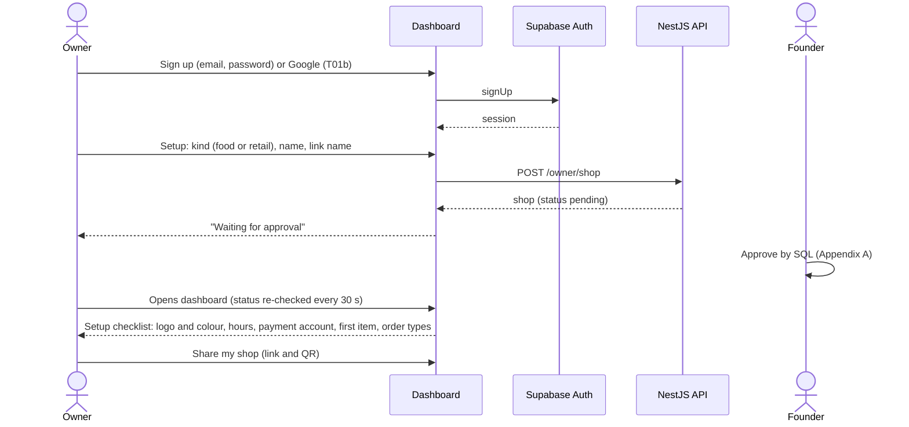
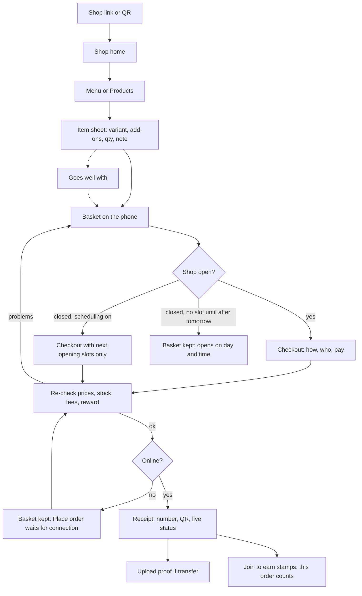
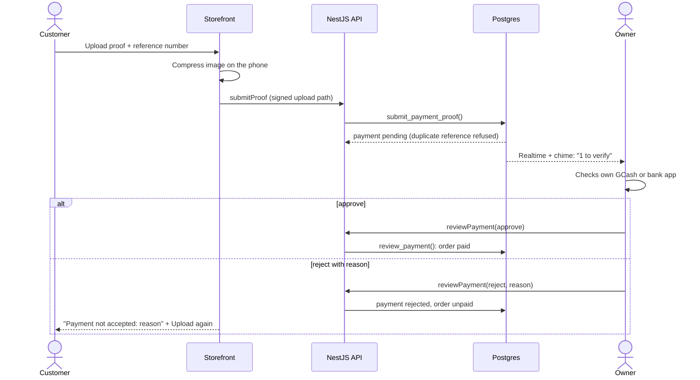
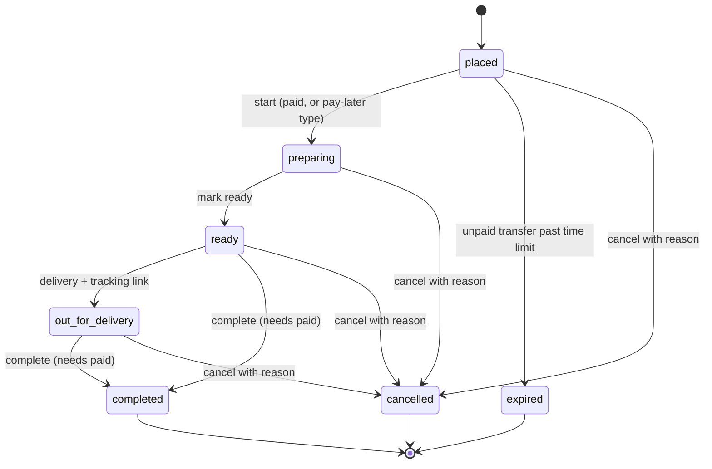
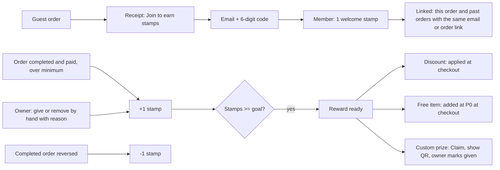
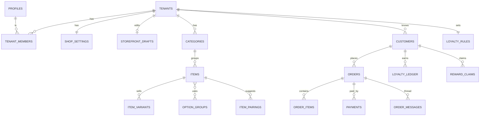
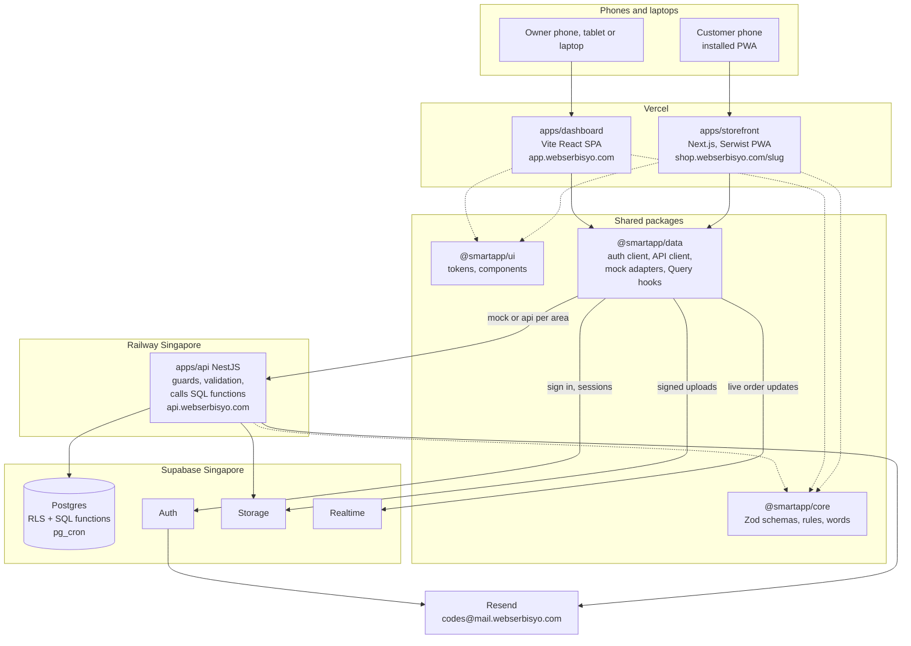

# Smart App PH: System Paper

An installable ordering app, a stamp card and an owner dashboard for small Philippine shops

Webserbisyo · Prepared for: Juan Miguel Morales (founder) · Version 2.0 · October 18, 2026

This paper says what Smart App PH is, why it exists, what ships in Launch MVP A, what waits for Launch MVP B, and how the system is designed. It replaces the old `system-paper.md` (version 1.1, October 12, 2026, in the abandoned repo) and is realigned to the restart: a new repo, a NestJS API from day 1, frontend first with mock data, and the decisions in [`decisions.md`](decisions.md).

How this paper fits with the other docs:

| Doc                                                                | Role                                                                                             |
| ------------------------------------------------------------------ | ------------------------------------------------------------------------------------------------ |
| This paper                                                         | The why and the what: problem, scope, flows, data, risks. Written for people                     |
| [`SMART_APP_PH_BLUEPRINT.md`](SMART_APP_PH_BLUEPRINT.md)           | The how and the where: sitemap, routes, page specs, detailed flows, schema, MVP B stubs          |
| [`RESEARCH.md`](RESEARCH.md)                                       | Ecosystem findings, library research, pilot metrics and test protocol                            |
| [`blueprints/`](blueprints/), [`ux.md`](ux.md), [`api.md`](api.md) | The short rule docs agents read. They and [`decisions.md`](decisions.md) are the source of truth |

If this paper disagrees with `decisions.md`, `AGENTS.md` or `blueprints/`, those win and this paper gets fixed in the next docs PR. New ideas go to section 15 (roadmap) never straight into the current task.

## Contents

1. [Introduction](#1-introduction)
2. [Review of existing solutions](#2-review-of-existing-solutions)
3. [Methodology](#3-methodology)
4. [Scope: Launch MVP A and Launch MVP B](#4-scope-launch-mvp-a-and-launch-mvp-b)
5. [Users and roles](#5-users-and-roles)
6. [System flows](#6-system-flows)
7. [Data design](#7-data-design)
8. [Architecture, stack and infrastructure](#8-architecture-stack-and-infrastructure)
9. [User interface and experience](#9-user-interface-and-experience)
10. [Security, privacy and reliability](#10-security-privacy-and-reliability)
11. [Business model](#11-business-model)
12. [Testing and acceptance](#12-testing-and-acceptance)
13. [Risks and limitations](#13-risks-and-limitations)
14. [Key decisions](#14-key-decisions)
15. [Roadmap: Launch MVP B](#15-roadmap-launch-mvp-b)
16. [Appendix A: Founder operations by SQL](#appendix-a-founder-operations-by-sql)
17. [Appendix B: Glossary](#appendix-b-glossary)

---

## 1. Introduction

### 1.1 Background

Small Philippine businesses such as cafés, burger stands, bakeshops, water refilling stations and clothing sellers take most of their orders through Facebook Messenger, phone calls and walk-ins. Orders get lost in long chat threads, payments arrive as GCash screenshots that are hard to match, and the owner has no list of regular customers to invite back. Delivery platforms solve ordering but charge a commission on every order and keep the customer relationship.

Smart App PH gives each shop its own installable ordering app (a progressive web app, PWA) and a simple dashboard. Customers order from the shop's own link or QR code, pay the shop directly, and join the shop's stamp card. The owner sees every order in one place and builds a member list they own. The pitch to owners: "May app ka na, may website ka pa."

### 1.2 Problem statement

1. Orders from Messenger, calls and walk-ins are not in one place, so they get missed or mixed up.
2. GCash and Maya payments are confirmed by screenshot with no reference check, which invites fake or reused proofs.
3. Owners have no customer list and no loyalty program, so one-time buyers do not come back.
4. Commission platforms take a cut of every order, and the shop does not own the customer.
5. A custom app is too expensive for a small shop, and generic store builders are priced in dollars and built for shipping, not walk-in and pickup.

### 1.3 General objective

To build and launch a multi-shop ordering platform where each small business gets an installable storefront app with a stamp card and an owner dashboard. Orders, payments and members live in one place, at a flat monthly fee with no commission.

### 1.4 Specific objectives (Launch MVP A)

1. Let customers browse, order and pay from a fast, installable phone app without creating an account.
2. Support the three common order types: walk-in, pickup (now or at a time) and delivery (zones with a fee).
3. Keep the customer's basket safe when the shop is closed or the phone is offline, and let a closed shop still take scheduled orders for its next opening.
4. Handle real menus and product lists: variants (such as size and colour), add-ons with required or optional rules, side-dish suggestions and favourites.
5. Record every order with a gap-free daily number and a receipt page with live status.
6. Accept cash, cash on delivery and GCash/Maya/bank transfers with an uploaded proof and reference number that the owner checks.
7. Let customers join as members with an email code, earn stamps and redeem one of three reward types, and let owners configure, track and adjust stamps with an audit trail.
8. Let the owner edit the real storefront on the page (look and content) with Draft and Publish.
9. Give the owner one dashboard for orders, catalog, members, insights and settings.
10. Keep every shop's data separate and secure, so more shops and the MVP B modules can be added without a rewrite.

### 1.5 Scope and limitations

In scope for Launch MVP A: everything in section 4.1.

Out of scope for Launch MVP A (planned for Launch MVP B, section 15): POS, cash shifts, kitchen screen, staff accounts and roles, inventory movements, promotions and vouchers, dine-in table QR, shipping, advance-order calendar, marketing push, full reports, platform admin screen, payment gateways, custom domains, the native dashboard app and AI features beyond the logo colour helper.

Limitations at launch:

- Payments are checked by the owner, not by a payment gateway.
- Order slips are not BIR official receipts ("ORDER SLIP · NOT AN OFFICIAL RECEIPT").
- iPhone users add the app to the home screen by hand; web push on iPhone works only after that.
- Delivery is booked by the owner in the rider's own app; Smart App PH stores the tracking link.
- The founder approves shops and records subscriptions with SQL, not an admin screen.

### 1.6 Significance

- **Shop owners:** fewer missed orders, safer payment checks, a member list they own, and a professional app for less than one day of sales a month.
- **Customers:** a clear menu, an order number and live status, a receipt they can keep, and rewards for coming back.
- **Webserbisyo:** one codebase and one database that one developer with AI agents can run for many shops.

## 2. Review of existing solutions

| Solution                             | What it does well                                                       | Gap for our target shops                                                            |
| ------------------------------------ | ----------------------------------------------------------------------- | ----------------------------------------------------------------------------------- |
| GrabFood, foodpanda                  | Huge reach, riders included                                             | Commission per order; the platform owns the customer; weak for walk-in and pickup   |
| Facebook page + Messenger            | Free; every customer already uses it                                    | No order list, no menu with prices, no payment check, orders lost in chat           |
| POS apps (Loyverse and similar)      | Counter selling, inventory, some loyalty                                | Built for the cashier, not for customers ordering from their own phone              |
| Store builders (Shopify and similar) | Full online stores                                                      | Priced in dollars, built for shipping; no stamp card or walk-in flow out of the box |
| Smart App PH                         | The shop's own app, ordering, members and stamps, flat fee, PH payments | No riders; manual payment checks at launch                                          |

Details and the research behind this table: [`RESEARCH.md`](RESEARCH.md) section 3.

## 3. Methodology

### 3.1 Development approach

Iterative and MVP-first: build the smallest version that works end to end, test it with real shops, then add one module at a time. Lessons from the two earlier builds became rules:

| What went wrong before                                       | Rule now                                                                                                     |
| ------------------------------------------------------------ | ------------------------------------------------------------------------------------------------------------ |
| Every feature at once (POS, kitchen, staff, shifts, promos)  | Launch MVP A only (section 4). Everything else is an MVP B stub until the first paying shops                 |
| The UI was redesigned three times                            | Decide the look once ([`ux.md`](ux.md), [`design-tokens.md`](design-tokens.md)) and build every screen in it |
| Agents hand-wrote components instead of using installed ones | UI only from installed libraries; a hand-written component needs the founder's OK                            |
| Large prompts produced messy code                            | One task per prompt, a plan first, then a PR with screenshots                                                |
| Backend and screens built together, slow to see anything     | Frontend first with mock data that uses the same Zod schemas as the API                                      |
| Database deploys on every push hit the live database         | One dev database now; a separate live database before the first paying shop; only the founder runs `db:push` |
| Docs grew long and drifted                                   | Short rule docs for agents; long docs (this one) for people; one fact in one place                           |

### 3.2 Tools and roles

| Who                                       | Does                                                                                            |
| ----------------------------------------- | ----------------------------------------------------------------------------------------------- |
| Founder                                   | Decides, pastes prompts into Antigravity, runs `db:push`, merges PRs                            |
| Claude                                    | Plans each task, writes the prompt, reviews Antigravity's plan and PR, writes docs              |
| Antigravity                               | Codes on `ag/t<nn>-<name>` branches, runs checks, takes screenshots, opens the PR               |
| GitHub, Vercel, Railway, Supabase, Resend | Code and CI; hosting for the two apps; API hosting; database, auth, storage and realtime; email |

### 3.3 Development phases

From [`blueprints/A-mvp.md`](blueprints/A-mvp.md) section 3:

| Phase                       | Done when                                                            |
| --------------------------- | -------------------------------------------------------------------- |
| 0 Foundation (T01, T01b)    | Each demo owner can log in; CI green                                 |
| 1 Kit and shell             | Both app shells work on phone and desktop with mock data             |
| 2 Storefront screens (mock) | Every storefront screen and state visible with all 5 demo shops      |
| 3 Dashboard screens (mock)  | The owner can do every MVP A job on mock data                        |
| 4 Backend, area by area     | Each area works on the dev database; mocks still pass the same tests |
| 5 Launch                    | The acceptance list (section 12) passes on a real phone              |

The proposed task list per phase is in [`SMART_APP_PH_BLUEPRINT.md`](SMART_APP_PH_BLUEPRINT.md) section 15.

## 4. Scope: Launch MVP A and Launch MVP B

### 4.1 Launch MVP A feature list

Priority: **Must** = no launch without it. **Should** = planned for MVP A; it may slip to just after launch without blocking the first paying shop.

| Area        | Feature                                                                                                                   | Priority                                                  |
| ----------- | ------------------------------------------------------------------------------------------------------------------------- | --------------------------------------------------------- |
| Storefront  | Shop home, Menu or Products with search, item sheet, basket, one-page checkout, receipt with live status, my orders       | Must                                                      |
| Storefront  | Phone app shell (top bar, 4-tab floating dock, basket bar); desktop two columns with a sticky basket                      | Must                                                      |
| Storefront  | Variants (up to 2 choices per item) and add-on groups with required or optional rules and min/max picks                   | Must                                                      |
| Storefront  | Basket kept on the phone; closed-shop scheduled orders for the next opening; offline basket kept with Place order waiting | Must                                                      |
| Storefront  | "Goes well with" side dishes and extras                                                                                   | Should                                                    |
| Storefront  | Favourites on the phone; "Order again" from past orders                                                                   | Should                                                    |
| Storefront  | Delivery zone pick, "Use my location" nearest zone, optional map pin, Google Maps link, straight-line km for the owner    | Must                                                      |
| Storefront  | Installable PWA (Serwist), offline page, install card after joining or a first order                                      | Must                                                      |
| Storefront  | Order thread with payment proof, private rating, Google review link                                                       | Must (thread), Should (rating)                            |
| Storefront  | Web push for order status after "Notify me"                                                                               | Should                                                    |
| Storefront  | Privacy page per shop, consent line, separate opt-ins                                                                     | Must                                                      |
| Order types | Walk-in, pickup (now or a time today or tomorrow), delivery (zones with a fee); each an owner switch                      | Must                                                      |
| Payments    | Cash, COD, GCash, Maya, bank with uploaded proof and reference; the owner approves or rejects                             | Must                                                      |
| Members     | Join with a 6-digit email code, 1 welcome stamp, stamps on completed paid orders, three reward types, member QR           | Must                                                      |
| Dashboard   | Home, Orders board and detail, Menu or Products, Members, Stamp card settings, manual stamps with audit, prize claims     | Must                                                      |
| Dashboard   | Editor: on-page live editing of the storefront with Draft and Publish                                                     | Must (content and look), Should (section on/off)          |
| Dashboard   | Logo colour helper (60/30/10 suggestions from the logo)                                                                   | Should                                                    |
| Dashboard   | Insights (7 and 30 days) and CSV export                                                                                   | Must (basic numbers), Should (members and ratings blocks) |
| Dashboard   | Settings: info, hours, closures, pause, order types, closed-shop scheduling, zones, payment accounts, account             | Must                                                      |
| Dashboard   | New-order email to the owner                                                                                              | Must                                                      |
| Platform    | Owner sign-up creates a pending shop; the founder approves by SQL                                                         | Must                                                      |
| Platform    | Google sign-in for owners (T01b)                                                                                          | Should                                                    |

Full feature catalog with IDs: [`SMART_APP_PH_BLUEPRINT.md`](SMART_APP_PH_BLUEPRINT.md) section 3.4. Tracker with checkboxes: [`README.md`](../README.md).

### 4.2 Scope calls on the founder's new asks

These were raised on October 18, 2026. The founder accepted them on October 18, 2026; they are N1 to N11 in [`decisions.md`](decisions.md).

| Ask                                                          | Call                               | Behaviour at launch and why                                                                                                                                                                                                                                                                                                                                                                                                                                                                                                                                                                                                                                                                                                                                                                                                                                                                                                                                           |
| ------------------------------------------------------------ | ---------------------------------- | --------------------------------------------------------------------------------------------------------------------------------------------------------------------------------------------------------------------------------------------------------------------------------------------------------------------------------------------------------------------------------------------------------------------------------------------------------------------------------------------------------------------------------------------------------------------------------------------------------------------------------------------------------------------------------------------------------------------------------------------------------------------------------------------------------------------------------------------------------------------------------------------------------------------------------------------------------------------- |
| Save orders when the shop is closed or offline               | A (scheduled order + saved basket) | **Closed or paused shop:** the basket always stays on the phone. If the owner turns on "Take orders while closed" (default on), checkout offers only the next opening slots (today or tomorrow, inside hours) for pickup or delivery, never "now" and never walk-in. It is a normal order with a pickup time, shown under "Scheduled" on the board. If the next opening is later than tomorrow, the basket is saved and the page says when the shop opens. **Customer offline:** the basket and checkout details stay; Place order says "You're offline. Your basket is saved." and turns back on when the phone reconnects, with a fresh price check. **Not** a queued order sent later in the background: Background Sync does not work on iPhone, prices and stock must be re-checked live, and a silent late order is worse than a clear "send now". Why A: it reuses the pickup-time rule A already has, needs no new status, and turns closed hours into sales. |
| Saved basket in the customer account                         | B                                  | A member's basket stays on that phone in A. A basket synced across devices needs a server cart, merge rules and clean-up; low value until members order from two devices.                                                                                                                                                                                                                                                                                                                                                                                                                                                                                                                                                                                                                                                                                                                                                                                             |
| Favourites                                                   | A on the phone, B synced           | Heart an item; saved with the basket on the phone; a Favourites chip on the menu. No backend in A. Synced favourites for members in B. "Order again" covers most repeat buying in A.                                                                                                                                                                                                                                                                                                                                                                                                                                                                                                                                                                                                                                                                                                                                                                                  |
| Side dishes                                                  | A                                  | Two separate things: **add-ons** (part of the line, such as extra patty, sugar level) and **"Goes well with"** (separate products suggested as their own lines, such as fries with a burger). The owner picks up to 4 per item. Combos stay one item with choice groups ("Choose your drink"); linking a choice to another product's stock is B.                                                                                                                                                                                                                                                                                                                                                                                                                                                                                                                                                                                                                      |
| Variants and add-ons, required or not                        | A                                  | Up to 2 variant choices per item (Size, Colour), at most 30 variants, each with its own price, stock and sold out. Add-on groups are a shared library with min and max picks: min 1 means required, max 1 means pick one. Rules in the blueprint section 8.1.                                                                                                                                                                                                                                                                                                                                                                                                                                                                                                                                                                                                                                                                                                         |
| Dashboard stamps: 3 types, configs, tracking, manual changes | A                                  | One stamp card per shop with one active reward of three types; first-time and returning customers tracked by order counts and dates; manual give and remove with a required reason, a daily cap, an append-only history and the audit log. Tiers, stamps per peso and expiry are B.                                                                                                                                                                                                                                                                                                                                                                                                                                                                                                                                                                                                                                                                                   |
| Editor with on-page live editing                             | A, limited                         | The owner edits the real storefront template in a preview of their own shop, section by section, then publishes. Fixed sections only: no drag-and-drop page builder, no custom blocks, no font choice. Section reorder is B.                                                                                                                                                                                                                                                                                                                                                                                                                                                                                                                                                                                                                                                                                                                                          |
| AI logo analyser with 60/30/10 colours                       | A as a colour helper, B as AI      | A: read the logo's main colours on the phone and suggest 3 palettes that pass the contrast check. No AI model is needed for this, so no cost or privacy risk. B: an AI brand assistant (tagline, palette names, banner text). Libraries chosen later.                                                                                                                                                                                                                                                                                                                                                                                                                                                                                                                                                                                                                                                                                                                 |
| Insights                                                     | A, basic                           | 7 and 30 days, numbers that lead to an action. No % comparisons, cohorts or date pickers in A (an empty new shop must look calm).                                                                                                                                                                                                                                                                                                                                                                                                                                                                                                                                                                                                                                                                                                                                                                                                                                     |
| Final left sidebar                                           | A                                  | Home, Orders, Menu or Products, Members, Editor, Insights, Settings, with View my shop and Share at the bottom. Section 9.3.                                                                                                                                                                                                                                                                                                                                                                                                                                                                                                                                                                                                                                                                                                                                                                                                                                          |
| New-order email to the owner (Claude's addition)             | A                                  | Owners work from their phones and will not keep the dashboard open. Without an alert outside the dashboard, missed orders are the biggest launch risk. Resend is already planned for launch.                                                                                                                                                                                                                                                                                                                                                                                                                                                                                                                                                                                                                                                                                                                                                                          |

### 4.3 Pushed back (not in Launch MVP A)

Each item below adds weeks or risk without helping the first paying shops. They stay in section 15 until a paying shop asks.

- POS, shifts, kitchen screen, staff: the owner works from one Orders board at launch.
- Inventory movements and stock value: a stock number per variant and sold out are enough.
- Promotions and vouchers: the stamp card is the launch promotion.
- Drag-and-drop page builder, custom fonts, custom blocks, section reorder.
- Server-synced baskets and favourites; scheduled orders beyond tomorrow (that is the advance-order module).
- Background order sending while offline.
- Stamp tiers, stamps per peso, stamp expiry.
- % comparisons, date-range pickers and cohorts in Insights.
- Customer Google sign-in, marketing push, SMS.
- An AI model call anywhere in MVP A.

### 4.4 Launch MVP B at a glance

The full product, built after the first paying shops, one module at a time, each switched off per shop until ready. Module list and order: [`blueprints/B-full.md`](blueprints/B-full.md). Stubs ready to fill in: [`SMART_APP_PH_BLUEPRINT.md`](SMART_APP_PH_BLUEPRINT.md) section 17. Summary in section 15 below.

## 5. Users and roles

| User                  | Uses                         | Signs in with                                      | Can do                                                                                                | MVP |
| --------------------- | ---------------------------- | -------------------------------------------------- | ----------------------------------------------------------------------------------------------------- | --- |
| Guest customer        | Storefront                   | Nothing (name and mobile, remembered on the phone) | Browse, favourite, order, pay, upload proof, track, rate                                              | A   |
| Member                | Storefront                   | Email and a 6-digit code                           | Everything a guest can, plus stamps, rewards, member QR, order history on any device, saved addresses | A   |
| Owner                 | Dashboard                    | Email and password; Google in T01b                 | Everything in their own shop; nothing in other shops                                                  | A   |
| Founder               | Supabase SQL editor          | Supabase account                                   | Approve or suspend shops, record subscription payments                                                | A   |
| Staff (cashier, prep) | Dashboard on a shared device | Username plus shop code                            | Named permissions (sell, orders, catalog)                                                             | B   |
| Platform admin        | Dashboard `/admin`           | Founder account                                    | Approvals, support mode, billing                                                                      | B   |

Words on screen follow the shop's kind through vocab: a food shop sees Menu and Kitchen, a retail shop sees Products and Packing. The code uses neutral words (tenant, item, catalog, prep) and never compares the shop type; features are switches.

Role and permission matrix (A columns are live at launch; B columns are designed now so the tables do not change later):

| Ability           | Owner (A) | Cashier (B) | Prep (B) | Notes                                    |
| ----------------- | :-------: | :---------: | :------: | ---------------------------------------- |
| `orders.view`     |    ✅     |     ✅      |    ✅    | Prep sees the board only                 |
| `orders.manage`   |    ✅     |     ✅      |    —     | Advance, record cash, cancel with reason |
| `payments.review` |    ✅     |     ✅      |    —     | Approve or reject proofs                 |
| `catalog.manage`  |    ✅     |      —      |    —     | Sold out switch is also `orders.manage`  |
| `members.view`    |    ✅     |     ✅      |    —     |                                          |
| `stamps.adjust`   |    ✅     |      —      |    —     | Manual stamps, with reason and cap       |
| `rewards.give`    |    ✅     |     ✅      |    —     | Mark a custom prize given                |
| `editor.publish`  |    ✅     |      —      |    —     |                                          |
| `insights.view`   |    ✅     |      —      |    —     |                                          |
| `settings.manage` |    ✅     |      —      |    —     |                                          |
| `sell.use` (POS)  |     B     |     ✅      |    —     |                                          |
| `staff.manage`    |     B     |      —      |    —     |                                          |

## 6. System flows

High-level flows. Step-by-step flows with every edge case: [`SMART_APP_PH_BLUEPRINT.md`](SMART_APP_PH_BLUEPRINT.md) section 6.

### 6.1 Shop onboarding



### 6.2 Order types in real life

| Type     | Real-life situation                                                                                    | Payment                                          | Status path                                           |
| -------- | ------------------------------------------------------------------------------------------------------ | ------------------------------------------------ | ----------------------------------------------------- |
| Walk-in  | The customer is in the shop, scans the counter QR, orders on their phone, waits for their number       | Cash at the counter, or GCash/Maya with proof    | Placed, Preparing, Ready, Completed                   |
| Pickup   | Orders ahead; picks up now or at a time today or tomorrow (also used for closed-shop scheduled orders) | Transfer with proof, or pay on pickup if allowed | Placed, Preparing, Ready, Completed                   |
| Delivery | Orders to an address in a zone; the owner books a rider and pastes a tracking link                     | Transfer with proof, or COD if allowed           | Placed, Preparing, Ready, Out for delivery, Completed |

End states for every type: Cancelled (with a reason) and Expired (unpaid transfer past the time limit). Nothing is deleted.

### 6.3 Customer ordering



### 6.4 Payment verification



A screenshot never marks an order paid; only the owner's check does.

### 6.5 Order lifecycle



Payment status runs beside it: `unpaid`, `pending` (proof uploaded), `paid`; a rejected proof returns to `unpaid`. A scheduled order is a `placed` order whose pickup time is later; the board shows it under "Scheduled" (computed in core, not a new status).

### 6.6 Members and stamps



Every stamp change is a row in an append-only history with who, why and when. Balance = sum of the history.

## 7. Data design

### 7.1 Rules

- Every shop-owned table has `tenant_id` and row-level security; RLS, grants and policies are in the same migration as the table; one cross-shop test per table.
- Money in integer centavos (₱120 = `12000`). Times stored in UTC, shown in Manila time; the order's business date is the Manila date.
- Closed lists (statuses, order types, payment methods, reward types) are text with a CHECK constraint, mirrored by an `as const` list and Zod enum in `packages/core`. No Postgres enums.
- Order lines copy the item name, variant, chosen add-ons and prices at order time; editing a product never changes old receipts.
- Money, stock and stamps change only through SQL functions (`security definer`, `set search_path = ''`). NestJS validates, checks the permission and calls them. Simple owner edits use RLS write rules.
- Append-only: order events, payments, stamp history, consents, audit log. Nothing with history is deleted; items with orders are archived.

### 7.2 Entity overview



Today the database has only `public.profiles` (T01). The tables above arrive area by area in phase 4, each in its own migration. Full schema with columns, SQL functions and how they map to API methods: [`SMART_APP_PH_BLUEPRINT.md`](SMART_APP_PH_BLUEPRINT.md) section 13.

### 7.3 File storage

| Bucket           | Public?     | Holds                                                             | Path rule                                                 |
| ---------------- | ----------- | ----------------------------------------------------------------- | --------------------------------------------------------- |
| `shop-media`     | Public read | Logos, banners, product photos, payment QR images, prize pictures | `<tenantId>/<folder>/<uuid>.webp`, never renamed          |
| `payment-proofs` | Private     | Customer proofs; owner views through 5-minute signed links        | `<tenantId>/<orderId>/<uuid>.webp`, deleted after 30 days |

Images are compressed to WebP on the phone before upload.

## 8. Architecture, stack and infrastructure

### 8.1 Architecture



Why this shape:

- **Two apps.** The storefront needs fast server-rendered pages that Google can find and that install as an app; that is Next.js. The dashboard is an app owners keep open all day and later wraps as a native app for printers and the POS; that is a static Vite build.
- **NestJS from day 1** ([`blueprints/foundation.md`](blueprints/foundation.md) F4 and section 8). One API for both apps and for MVP B modules (staff, POS, integrations). It stays thin: validate, check the permission, call the SQL function. Money, stock and stamps stay in SQL, so there is one place for those rules.
- **Mock first.** Screens talk only to `@smartapp/data` hooks. Each area switches from the mock adapter to the API adapter when its backend lands; [`api.md`](api.md) is the contract both follow.
- **Auth direct to Supabase.** Sign-in and sessions go straight to Supabase Auth; the API checks the access token against the project's JWKS.

### 8.2 Stack

The stack table with the reason for each part is in [`blueprints/foundation.md`](blueprints/foundation.md) section 2. Verified versions and the ecosystem notes are in [`RESEARCH.md`](RESEARCH.md) section 1. In short: pnpm 12 + Turborepo, Node 24.14 pinned, TypeScript 6.0 strict, Next.js 16.4, Vite 8, NestJS 12 on Express by hand, Supabase, Tailwind v4, shadcn on Base UI with ReUI, DiceUI and Magic UI, Vercel, Railway, Resend.

### 8.3 Environments and domains

| Now                                                       | Before the first paying shop                                                                   |
| --------------------------------------------------------- | ---------------------------------------------------------------------------------------------- |
| Supabase "Smart App PH MVP FINAL" (dev, demo data only)   | A separate live Supabase project with backups; the dev project becomes staging                 |
| Apps and API on the founder's Mac; no Docker              | Vercel Pro from `main`; Railway Singapore for the API                                          |
| Migrations reach dev only when the founder runs `db:push` | Migrations reach live only by a manual GitHub Action after review; branch protection on `main` |

Domains (subdomains of webserbisyo.com only): `shop.webserbisyo.com/<slug>` (storefront), `app.webserbisyo.com` (dashboard), `api.webserbisyo.com` (API), `codes@mail.webserbisyo.com` (Resend sender). Custom domains per shop are MVP B.

### 8.4 Growth path

| Stage          | Shops            | Setup                                                                     |
| -------------- | ---------------- | ------------------------------------------------------------------------- |
| Build and demo | 0 paying         | Vercel Hobby, Supabase Free, API local                                    |
| Launch         | 1 to about 100   | Vercel Pro, Supabase Pro (daily backups), Railway Hobby, Resend free tier |
| Growth         | About 100 to 300 | Bigger Supabase compute; image storage moved if it grows                  |

Costs are checked at launch time; see [`RESEARCH.md`](RESEARCH.md) section 1.3 (assumed, not verified today).

## 9. User interface and experience

### 9.1 Principles

Phone first for Filipino users on mid-range phones and slow data. One filled button per screen; the next step is always obvious. Every status is an icon, a word and a colour, and amber means "it needs you". Every screen has loading, empty, error, offline, closed-shop, long-text and big-amount states. Plain English with local words where natural (Suki, Members). Full rules: [`ux.md`](ux.md). Tokens: [`design-tokens.md`](design-tokens.md).

### 9.2 Look

- **Storefront:** light only. The owner's one brand colour and logo generate a 60/30/10 palette (60 page, 30 surfaces, 10 main button and highlights) with a contrast check. Status and member colours never follow the brand.
- **Dashboard:** light and dark, platform blue, Plus Jakarta Sans, lucide icons, teal for members, marigold only for celebrations.

### 9.3 Navigation

| Surface    | Phone                                                                                                       | Desktop                                                                                                                                |
| ---------- | ----------------------------------------------------------------------------------------------------------- | -------------------------------------------------------------------------------------------------------------------------------------- |
| Storefront | Floating dock: Home · Menu or Products · Rewards · Orders; basket bar above it; Account from the avatar     | Top navigation, two columns, sticky basket column from 1280 px (right drawer from 1024 to 1279 px)                                     |
| Dashboard  | Bottom dock: Home · Orders · Menu or Products · Members · More (Editor, Insights, Settings, Share, Account) | Sidebar: Home · Orders · Menu or Products · Members · Editor · Insights · Settings; View my shop and Share at the bottom; account menu |

These labels are decision N9; [`ux.md`](ux.md) section 1 uses them.

## 10. Security, privacy and reliability

- **Shop isolation:** RLS on every table in the same migration; the API takes the shop from `tenant_members`, never from the URL or body; every API route has `@Public()` or `@Can()` (a test fails otherwise); cross-shop tests per table. Another shop's pages show Not found, never "forbidden".
- **Auth:** owners by email and password (Google in T01b); members by a 6-digit email code; codes, never links. One error for every failed login. Server code checks the user with `getClaims()`, never `getSession()`. The API checks `iss`, `aud` and `exp` against the JWKS.
- **Trusted numbers:** prices, totals, fees, rewards, stock and stamps are recomputed in SQL; the phone's numbers are never trusted.
- **Payments:** proofs are private, shown to the owner through 5-minute signed links, at most 3 per order, uploaded within 7 days, deleted after 30 days (the payment row stays). A reference number works once per shop.
- **Abuse:** at most 3 unpaid orders per phone per 30 minutes and 30 orders per shop per minute; throttling on public API routes; manual stamps capped per member per day.
- **Secrets:** apps hold only the Supabase URL and publishable key; the secret key lives in the API env and scripts only; no `.env` file is ever read, printed or committed.
- **Data Privacy Act (RA 10173):** a privacy notice per shop (plain English plus a short Filipino summary), a consent line at checkout, separate unticked opt-ins for marketing per channel stored with time and source, customer data used only by that shop, no customer data in logs.
- **Receipts:** order slips say "ORDER SLIP · NOT AN OFFICIAL RECEIPT"; shops keep issuing BIR receipts their usual way.
- **Reliability:** a retry of the same checkout returns the same order (client key); the dashboard polls every 15 seconds when realtime drops; daily backups on the live project before the first paying shop.

## 11. Business model

| Item              | Value                                                                                                   |
| ----------------- | ------------------------------------------------------------------------------------------------------- |
| Plan              | One plan per shop per month, no commission: storefront app, dashboard, members and stamps               |
| Price             | **Open:** ₱599 or ₱799 per month ([`decisions.md`](decisions.md) "Open")                                |
| Fixed tool cost   | Vercel Pro, Supabase Pro, Railway and the domain; checked at launch (assumed about US$50 to 60 a month) |
| Billing at launch | The shop pays by GCash, Maya or bank; the founder records the payment by SQL (Appendix A)               |
| Later add-ons     | Setup service, custom domain, extra storage, staff seats (MVP B)                                        |

Subscription states (enforced by a scheduled job later): Active; Overdue days 1 to 7 (banner); Restricted days 8 to 30 (orders work, edits locked); Paused after day 30 (storefront shows the menu and a Messenger button only).

## 12. Testing and acceptance

Every phase is tested with a food shop and a retail shop from [`demo-shops.md`](demo-shops.md), on a phone (390 px) and a desktop (1280 px). Launch MVP A is accepted when all of these pass on a real phone. Items 1 to 8 come from [`blueprints/A-mvp.md`](blueprints/A-mvp.md) section 5; items 9 to 16 cover the new scope in section 4.2.

1. A customer orders on a phone in under a minute (pickup GCash and walk-in cash).
2. The owner sees the new order without refreshing and finishes it.
3. A rejected proof can be sent again; an approved one marks the order paid.
4. A member joins, earns stamps and redeems a reward.
5. Shop A can never see shop B's data (tested).
6. The storefront installs on Android and iPhone, opens the saved copy instantly and shows an offline page. Stock, prices and open/closed are fetched fresh before checkout. "Add to home screen" is offered after joining or a first order.
7. Lighthouse mobile performance 90 or more on shop home and menu; first-load JavaScript at most 200 kB gzipped per page; CLS under 0.1.
8. A privacy page per shop is linked from checkout, account and the footer; marketing opt-ins are separate and unticked.
9. With the shop closed and scheduling on, a customer places a pickup order for the next opening slot; it shows under Scheduled on the board. With scheduling off, the basket is kept and checkout says when the shop opens.
10. With the phone offline, the basket and checkout details survive a reload, Place order says why it is off, and the order goes through after reconnecting with a fresh price check.
11. An item with a required size, a required "choose 1" group and an optional "up to 3" group cannot be added until the required picks are made; the server refuses a payload that breaks the rules.
12. A price changed after adding to the basket is flagged at checkout and the new price is used.
13. Each reward type works end to end: discount applied, free item added at ₱0 (extras charged), custom prize claimed and marked given; cancelling the order or the claim returns the stamps.
14. The owner gives 1 stamp by hand with a reason; it appears in the member's history with the owner's name; a 4th manual stamp that day for the same member is refused.
15. The owner edits a banner and the colour in the Editor, sees it on the preview, and customers see it only after Publish.
16. The owner gets a new-order email within a minute of a placed order.

The QA matrix per screen is in [`SMART_APP_PH_BLUEPRINT.md`](SMART_APP_PH_BLUEPRINT.md) section 16; pilot metrics and the usability test are in [`RESEARCH.md`](RESEARCH.md) section 4.

## 13. Risks and limitations

| Risk                                         | Handling                                                                                                |
| -------------------------------------------- | ------------------------------------------------------------------------------------------------------- |
| Scope grows again                            | Section 4 is the launch list. New ideas go to section 15 until after launch                             |
| Owner misses orders                          | Chime, tab count and realtime on the dashboard; new-order email; the customer's Messenger hand-off      |
| Fake payment screenshots                     | Unique reference per shop; the owner checks their own wallet app; every approval logged                 |
| Stamp abuse by staff or owner friends        | Manual stamps need a reason, are capped per member per day, and show in the history and audit log       |
| Scheduled orders the owner forgets           | "Scheduled" group on the board, shown on Home at opening time; the new-order email says the pickup time |
| Editor publishes a broken look               | Draft and Publish; contrast check blocks unreadable palettes; fixed sections only                       |
| NestJS adds a moving part before it pays off | It starts tiny (health, auth, seed); Railway only from the first wired area; rules stay in SQL          |
| iPhone install and push friction             | Install card with steps after a first order or joining; push only after Add to Home Screen              |
| Email codes not delivered                    | Resend SMTP before launch; Supabase's built-in email is not used in production                          |
| Data leaking between shops                   | RLS on every table, the API guard and a cross-shop test per table                                       |
| Founder's old laptop (macOS 12, Node 24.14)  | Node pinned; packages that need newer Node pinned to older versions; no Docker                          |
| One-person business                          | These docs, `AGENTS.md`, small tasks and PR history keep work resumable; daily backups                  |

## 14. Key decisions

Approved decisions live in [`decisions.md`](decisions.md) (P1 to P9 product, T1 to T19 tech) and [`blueprints/foundation.md`](blueprints/foundation.md) (F1 to F10). They are not repeated here.

**Accepted on October 18, 2026 (also in `decisions.md`):**

| #   | Decision                                                                                                                                                                      |
| --- | ----------------------------------------------------------------------------------------------------------------------------------------------------------------------------- |
| N1  | Closed or paused shop: keep the basket; "Take orders while closed" (default on) offers next-opening slots today or tomorrow for pickup and delivery only; no new order status |
| N2  | Offline: keep basket and checkout details; Place order waits for the connection and re-quotes; no background order sending                                                    |
| N3  | Favourites on the phone only in A; synced favourites and baskets are B                                                                                                        |
| N4  | Variants: up to 2 choices per item and 30 variants; add-on groups are a shared library with min and max picks; "Goes well with" up to 4 items per item                        |
| N5  | One stamp card per shop with one active reward of three types; manual stamps need a reason, at most 3 per member per day, owner only                                          |
| N6  | Member QR opens the dashboard member page when scanned with the phone camera (no scanner in the app)                                                                          |
| N7  | Editor in A: fixed sections, edit in place on a live preview, Draft and Publish, section on/off; no reorder, fonts or custom blocks                                           |
| N8  | Logo colour helper without an AI model in A; AI brand assistant in B                                                                                                          |
| N9  | Dashboard navigation: Home, Orders, Menu or Products, Members, Editor, Insights, Settings (changes `ux.md` section 1)                                                         |
| N10 | New-order email to the owner is part of MVP A                                                                                                                                 |
| N11 | Receipt can be saved as an image (made on the server from the order) or printed and saved as PDF; no new package                                                              |

## 15. Roadmap: Launch MVP B

Each module is a database task, an API task, then one task per screen, switched off per shop until ready. Build order follows [`blueprints/B-full.md`](blueprints/B-full.md); the stubs in [`SMART_APP_PH_BLUEPRINT.md`](SMART_APP_PH_BLUEPRINT.md) section 17 are where the detail goes.

| #   | Module              | Adds                                                                                    |
| --- | ------------------- | --------------------------------------------------------------------------------------- |
| M1  | Staff and roles     | Seats, staff logins, named permissions                                                  |
| M2  | Account and audit   | Profile, security, activity log screens                                                 |
| M3  | Notifications       | Outbox, owner alerts, alerts bell                                                       |
| M4  | Inventory           | Stock movements with reasons, restock, low stock, value                                 |
| M5  | Settings extras     | Tables and QR, tax, approval PIN                                                        |
| M6  | Dine-in             | Table ordering                                                                          |
| M7  | Shifts              | Open, cash in and out, blind close                                                      |
| M8  | POS                 | Sell screen, senior and PWD discount, slip                                              |
| M9  | Voids and approvals | Void with PIN                                                                           |
| M10 | Kitchen and packing | Prep board                                                                              |
| M11 | Advance orders      | Calendar, lead days, deposits                                                           |
| M12 | Marketing           | Vouchers, promotions, announcements, member push                                        |
| M13 | Customers extended  | Notes, block, export, anonymize; synced favourites and baskets; customer Google sign-in |
| M14 | Full reports        | Breakdowns, comparisons, cohorts, CSV, Google Sheets                                    |
| M15 | Shipping            | By region                                                                               |
| M16 | Platform            | `/admin`, approvals, support mode, billing states                                       |
| M17 | Integrations        | PayMongo, Meta Conversions API, Lalamove, Google Sheets                                 |
| M18 | Native app          | Capacitor dashboard, Bluetooth printers                                                 |
| M19 | Loyalty extras      | Reward tiers, stamps per peso, expiry, double-stamp days                                |
| M20 | AI                  | Brand assistant, insight summaries                                                      |
| M21 | Editor extras       | Section reorder, more templates, custom domains                                         |

## Appendix A: Founder operations by SQL

Saved snippets for the Supabase SQL editor. They use the planned `tenants` and `tenant_members` tables (phase 4); they do not run before those exist. Run on the live project only after review.

Shops waiting for approval:

```sql
select t.slug, t.name, t.kind, t.created_at, u.email
from tenants t
join tenant_members m on m.tenant_id = t.id and m.role = 'owner'
join auth.users u on u.id = m.user_id
where t.status = 'pending'
order by t.created_at;
```

Approve a shop with the first month paid:

```sql
update tenants
set status = 'active', paid_until = current_date + interval '1 month'
where slug = 'kanto-smash';
```

Record a monthly payment (extends from the later of today or the current `paid_until`):

```sql
update tenants
set paid_until = greatest(current_date, paid_until) + interval '1 month'
where slug = 'kanto-smash';
```

Shops due or overdue:

```sql
select slug, name, paid_until, current_date - paid_until as days_overdue
from tenants
where status = 'active' and paid_until < current_date + 3
order by paid_until;
```

Suspend or restore:

```sql
update tenants set status = 'suspended' where slug = 'some-shop';
update tenants set status = 'active' where slug = 'some-shop';
```

## Appendix B: Glossary

| Term                    | Meaning                                                                                   |
| ----------------------- | ----------------------------------------------------------------------------------------- |
| Tenant, shop            | One business account. The code says tenant; screens say shop                              |
| Storefront              | The customer app of one shop                                                              |
| Dashboard               | The owner app                                                                             |
| PWA                     | A website that installs like an app and opens full screen from the home screen            |
| Serwist                 | The library that makes the storefront installable and caches it                           |
| Fulfillment, order type | How the order reaches the customer: walk-in, pickup, delivery                             |
| Scheduled order         | A pickup or delivery order with a later time, such as one placed while the shop is closed |
| Variant                 | A version of an item with its own price and stock (Large, or Size M and Colour Black)     |
| Add-on group, option    | Extras chosen inside one line (sugar level, extra patty), with min and max picks          |
| Goes well with          | Other products suggested next to an item, added as their own lines                        |
| Member                  | A customer who joined with an email code and collects stamps                              |
| Stamp history, ledger   | The append-only list of stamp changes; the balance is its sum                             |
| Suki                    | A regular customer                                                                        |
| Editor                  | The dashboard page where the owner edits the storefront on a live preview                 |
| 60/30/10                | Colour rule: 60% page, 30% surfaces, 10% main buttons and highlights                      |
| RLS                     | Row-level security: database rules that decide which rows each user can read or change    |
| Slug                    | The shop's link name, such as `kanto-smash`                                               |
| Centavos                | Money stored as whole numbers: ₱1.00 = 100                                                |
| MVP A, MVP B            | Launch MVP A (first paying shops) and Launch MVP B (the full product after launch)        |
